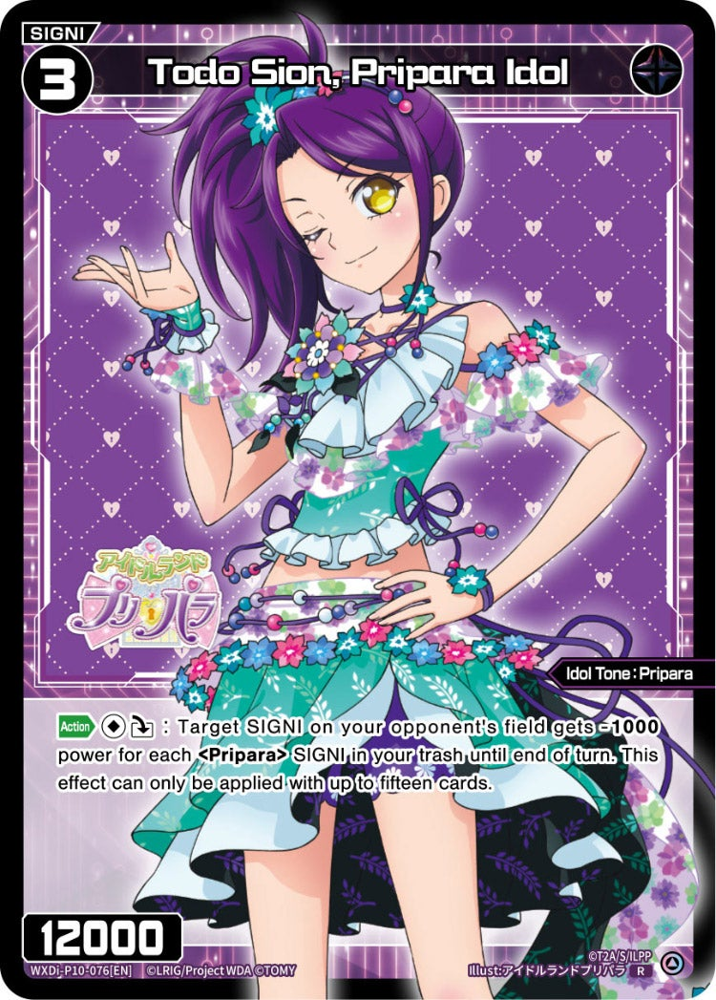

# Todo Sion, Pripara Idol

## Thông tin lá

| Trường | Giá trị |
| --- | --- |
| Mã in | WXDi-P10-076[EN] |
| Set | WXDi-P10[EN] |
| Số thứ tự | 076 |
| Loại thẻ | SIGNI |
| Vị trí | Main Deck |
| Số bản | — (set booster, không áp dụng) |
| Màu | Đen |
| Độ hiếm | R,R(P) |
| Minh họa | アイドルランドプリパラ |
| Level | 3 |
| Limit | — |
| Power | 12000 |
| LRIG type / Class | Idol Tone：Pripara |
| Team / Master | — |
| Cost | — |
| Grow cost | — |
| Use timing | — |
| Life Burst | Không |

## Card text chính thức

[Action] {Colorless} {Down}: Target SIGNI on your opponent's field gets -1000 power for each <Pripara> SIGNI in your trash until end of turn. This effect can only be applied with up to fifteen cards.

## Power text / Life Burst

—

## Ghi chú minh họa
Artist: アイドルランドプリパラ. Ảnh R được tải từ Card List tiếng Anh.

## FAQ chính thức

**Q. What happens if I used this [Action] ability when there were twenty <Pripara> SIGNI in my trash?**
A. The effects of this [Action] ability only apply up to fifteen cards, so your opponent's SIGNI gets -15000 power.

## Ảnh biến thể

- [R(P)](../images/WXDi-P10-076P-EN.jpg)

## Nguồn
[Card List/FAQ chính thức](https://www.takaratomy.co.jp/products/en.wixoss/card/card.html?card_no=WXDi-P10-076%5BEN%5D ) · [Ảnh thẻ](https://www.takaratomy.co.jp/products/en.wixoss/card/thumb/WXDi-P10-076%5BEN%5D.jpg)
