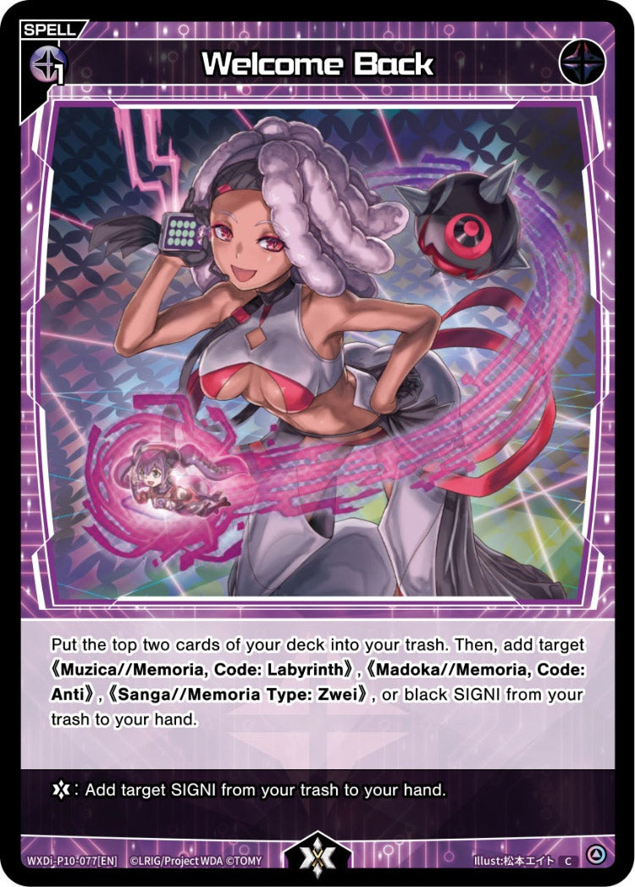

# Welcome Back

## Thông tin lá

| Trường | Giá trị |
| --- | --- |
| Mã in | WXDi-P10-077[EN] |
| Set | WXDi-P10[EN] |
| Số thứ tự | 077 |
| Loại thẻ | SPELL |
| Vị trí | Main Deck |
| Số bản | — (set booster, không áp dụng) |
| Màu | Đen |
| Độ hiếm | C,C(P) |
| Minh họa | 松本エイト |
| Level | — |
| Limit | — |
| Power | 0 |
| LRIG type / Class | — |
| Team / Master | — |
| Cost | 《B》×１ |
| Grow cost | — |
| Use timing | — |
| Life Burst | Có |

## Card text chính thức

Put the top two cards of your deck into your trash. Then, add target 《Muzica//Memoria, Code: Labyrinth》, 《Madoka//Memoria, Code: Anti》, 《Sanga//Memoria Type: Zwei》, or black SIGNI from your trash to your hand.

## Power text / Life Burst

Add target SIGNI from your trash to your hand.

## Ghi chú minh họa
Artist: 松本エイト. Ảnh C được tải từ Card List tiếng Anh.

## FAQ chính thức

— (không có FAQ riêng cho mã này trên trang FAQ tiếng Anh.)

## Ảnh biến thể

- [C(P)](../images/WXDi-P10-077P-EN.jpg)

## Nguồn
[Card List/FAQ chính thức](https://www.takaratomy.co.jp/products/en.wixoss/card/card.html?card_no=WXDi-P10-077%5BEN%5D ) · [Ảnh thẻ](https://www.takaratomy.co.jp/products/en.wixoss/card/thumb/WXDi-P10-077%5BEN%5D.jpg)
