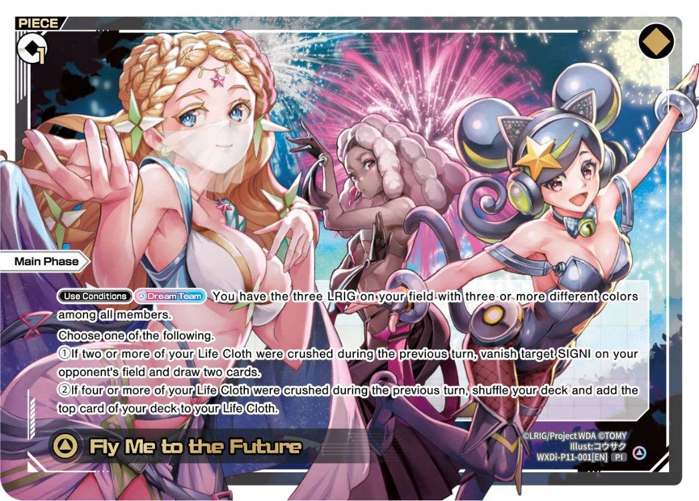

# Fly Me to the Future

## Thông tin lá

| Trường | Giá trị |
| --- | --- |
| Mã in | WXDi-P11-001[EN] |
| Set | WXDi-P11[EN] |
| Số thứ tự | 001 |
| Loại thẻ | PIECE |
| Vị trí | LRIG Deck |
| Số bản | — (set booster, không áp dụng) |
| Màu | Không màu |
| Độ hiếm | PI,LRP |
| Minh họa | コウサク |
| Level | — |
| Limit | — |
| Power | 0 |
| LRIG type / Class | — |
| Team / Master | — |
| Cost | 《C》×１ |
| Grow cost | — |
| Use timing | Main Phase |
| Life Burst | Không |

## Card text chính thức

[Use Conditions] [Dream Team] You have the three LRIG on your field with three or more different colors among all members.

Choose one of the following.
①If two or more of your Life Cloth were crushed during the previous turn, vanish target SIGNI on your opponent's field and draw two cards.
②If four or more of your Life Cloth were crushed during the previous turn, shuffle your deck and add the top card of your deck to your Life Cloth.

## Power text / Life Burst

—

## Ghi chú minh họa
Artist: コウサク. Ảnh PI được tải từ Card List tiếng Anh.

## FAQ chính thức

**Q. Two my Life Cloth were crushed during the previous turn, and I added a card from my trash to my Life Cloth in this turn by some effect. Can I use the effect (1) of 《Fly Me to the Future》?**
A. Yes, you can. This condition only checks how many Life Cloth were crushed, and does not affect any subsequent increase in Life Cloth.

## Ảnh biến thể

- [LRP](../images/WXDi-P11-001P-EN.jpg)

## Nguồn
[Card List/FAQ chính thức](https://www.takaratomy.co.jp/products/en.wixoss/card/card.html?card_no=WXDi-P11-001%5BEN%5D ) · [Ảnh thẻ](https://www.takaratomy.co.jp/products/en.wixoss/card/thumb/WXDi-P11-001%5BEN%5D.jpg)
