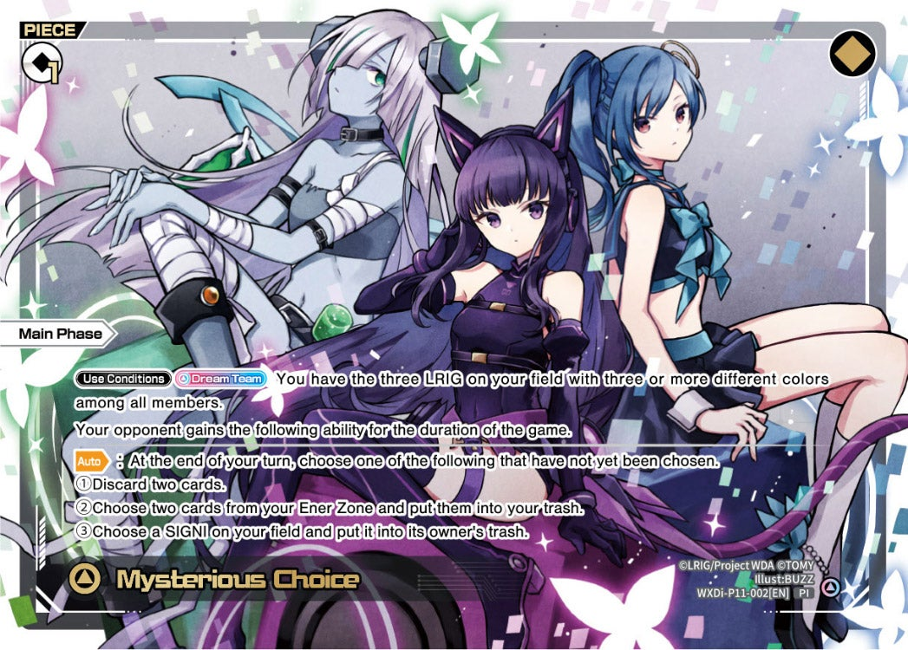

# Mysterious Choice

## Thông tin lá

| Trường | Giá trị |
| --- | --- |
| Mã in | WXDi-P11-002[EN] |
| Set | WXDi-P11[EN] |
| Số thứ tự | 002 |
| Loại thẻ | PIECE |
| Vị trí | LRIG Deck |
| Số bản | — (set booster, không áp dụng) |
| Màu | Không màu |
| Độ hiếm | PI,LRP |
| Minh họa | BUZZ |
| Level | — |
| Limit | — |
| Power | 0 |
| LRIG type / Class | — |
| Team / Master | — |
| Cost | 《C》×１ |
| Grow cost | — |
| Use timing | Main Phase |
| Life Burst | Không |

## Card text chính thức

[Use Conditions] [Dream Team] You have the three LRIG on your field with three or more different colors among all members.

Your opponent gains the following ability for the duration of the game.
『[Auto]: At the end of your turn, choose one of the following that have not yet been chosen.
①Discard two cards.
②Choose two cards from your Ener Zone and put them into your trash.
③Choose a SIGNI on your field and put it into its owner's trash.』

## Power text / Life Burst

—

## Ghi chú minh họa
Artist: BUZZ. Ảnh PI được tải từ Card List tiếng Anh.

## FAQ chính thức

**Q. Who chooses among the three modes of the [Auto] ability?**
A. The player who was granted this ability chooses.

**Q. What happens to this ability at the end of the next turn after choosing all (1), (2) and (3)?**
A. Nothing will happen in subsequent turns after all have been chosen.

**Q. May I choose (1) when I have one or zero cards in my hand?**
A. Yes, you can. If you have one, you discard it and if you have zero, nothing happens. Even if nothing happens, (1) is treated as choise. Similarly, you can choose (2) when there are no cards in the Ener zone and (3) when there are no SIGNI in your SIGNI zone.

## Ảnh biến thể

- [LRP](../images/WXDi-P11-002P-EN.jpg)

## Nguồn
[Card List/FAQ chính thức](https://www.takaratomy.co.jp/products/en.wixoss/card/card.html?card_no=WXDi-P11-002%5BEN%5D ) · [Ảnh thẻ](https://www.takaratomy.co.jp/products/en.wixoss/card/thumb/WXDi-P11-002%5BEN%5D.jpg)
