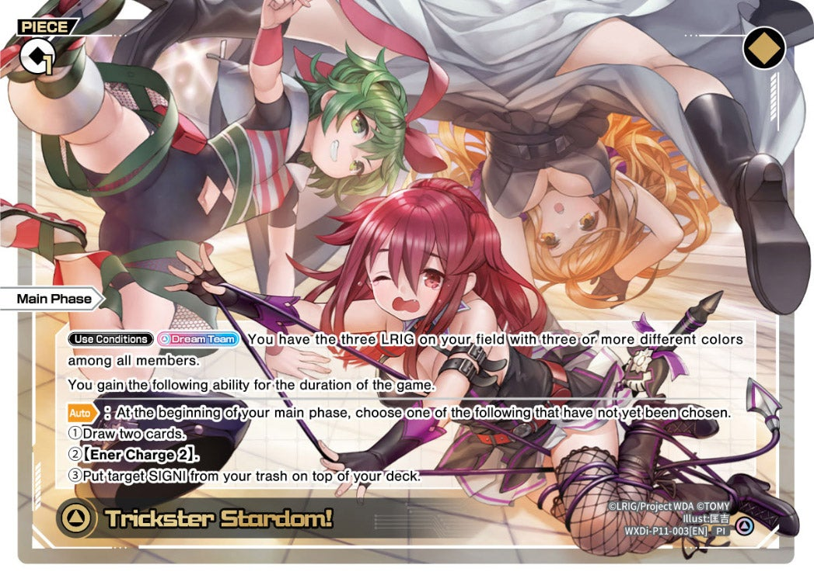

# Trickster Stardom!

## Thông tin lá

| Trường | Giá trị |
| --- | --- |
| Mã in | WXDi-P11-003[EN] |
| Set | WXDi-P11[EN] |
| Số thứ tự | 003 |
| Loại thẻ | PIECE |
| Vị trí | LRIG Deck |
| Số bản | — (set booster, không áp dụng) |
| Màu | Không màu |
| Độ hiếm | PI,LRP |
| Minh họa | 匡吉 |
| Level | — |
| Limit | — |
| Power | 0 |
| LRIG type / Class | — |
| Team / Master | — |
| Cost | 《C》×１ |
| Grow cost | — |
| Use timing | Main Phase |
| Life Burst | Không |

## Card text chính thức

[Use Conditions] [Dream Team] You have the three LRIG on your field with three or more different colors among all members.

You gain the following ability for the duration of the game.
『[Auto]: At the beginning of your main phase, choose one of the following that have not yet been chosen.
①Draw two cards.
②【Ener Charge 2】.
③Put target SIGNI from your trash on top of your deck.』

## Power text / Life Burst

—

## Ghi chú minh họa
Artist: 匡吉. Ảnh PI được tải từ Card List tiếng Anh.

## FAQ chính thức

**Q. What happens to this ability at the beginning of the next main phase after choosing all (1), (2) and (3)?**
A. Nothing will happen in subsequent turns after all have been chosen.

## Ảnh biến thể

- [LRP](../images/WXDi-P11-003P-EN.jpg)

## Nguồn
[Card List/FAQ chính thức](https://www.takaratomy.co.jp/products/en.wixoss/card/card.html?card_no=WXDi-P11-003%5BEN%5D ) · [Ảnh thẻ](https://www.takaratomy.co.jp/products/en.wixoss/card/thumb/WXDi-P11-003%5BEN%5D.jpg)
