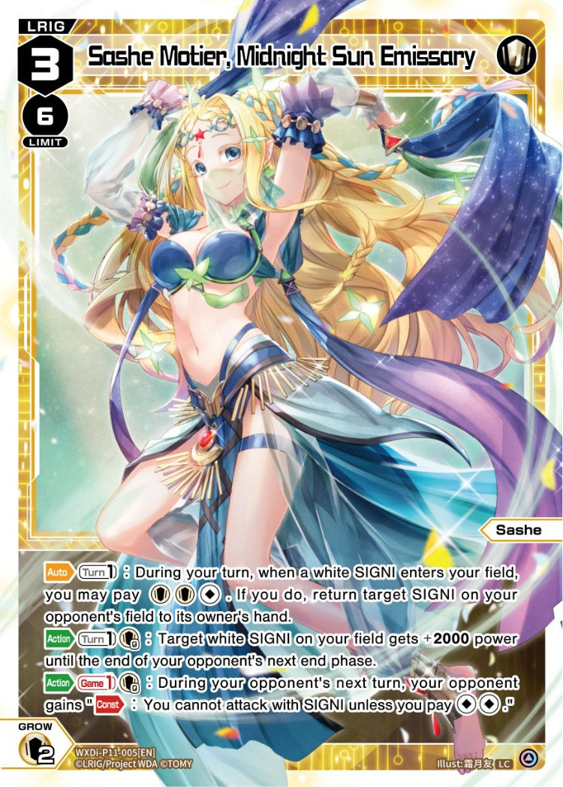

# Sashe Motier, Midnight Sun Emissary

## Thông tin lá

| Trường | Giá trị |
| --- | --- |
| Mã in | WXDi-P11-005[EN] |
| Set | WXDi-P11[EN] |
| Số thứ tự | 005 |
| Loại thẻ | LRIG |
| Vị trí | LRIG Deck |
| Số bản | — (set booster, không áp dụng) |
| Màu | Trắng |
| Độ hiếm | LC,LR,LRP,UR |
| Minh họa | 霜月友 |
| Level | 3 |
| Limit | 6 |
| Power | 0 |
| LRIG type / Class | Sashe |
| Team / Master | — |
| Cost | — |
| Grow cost | 《W》×２ |
| Use timing | — |
| Life Burst | Không |

## Card text chính thức

[Auto] {1/Turn}: During your turn, when a white SIGNI enters your field, you may pay {White} {White} {Colorless}. If you do, return target SIGNI on your opponent's field to its owner's hand.
[Action] {1/Turn} {Whitex0}: Target white SIGNI on your field gets +2000 power until the end of your opponent's next end phase.
[Action] {1/Game} {Whitex0}: During your opponent's next turn, your opponent gains "[Constant]: You cannot attack with SIGNI unless you pay {Colorless} {Colorless}."

## Power text / Life Burst

—

## Ghi chú minh họa
Artist: 霜月友. Ảnh LC được tải từ Card List tiếng Anh.

## FAQ chính thức

**Q. Does the [Auto] ability target my opponent's SIGNI even if I do not pay {white} {white} {colorless}?**
A. Yes, first target one of your opponent's SIGNI, then decide whether to pay {white} {white} {colorless}.

**Q. After using the second [Action] ability, does my opponent have to pay {colorless} {colorless} each time their SIGNI tries to attack?**
A. Yes, your opponent must pay each time attack with SIGNI. For example, if your opponet attack three times with three SIGNI, your opponent will have to pay a total of six {colorless}.

## Ảnh biến thể

- [LRP](../images/WXDi-P11-005P-EN.jpg)
- [LR](../images/WXDi-P11-005R-EN.jpg)
- [UR](../images/WXDi-P11-005U-EN.jpg)

## Nguồn
[Card List/FAQ chính thức](https://www.takaratomy.co.jp/products/en.wixoss/card/card.html?card_no=WXDi-P11-005%5BEN%5D ) · [Ảnh thẻ](https://www.takaratomy.co.jp/products/en.wixoss/card/thumb/WXDi-P11-005%5BEN%5D.jpg)
