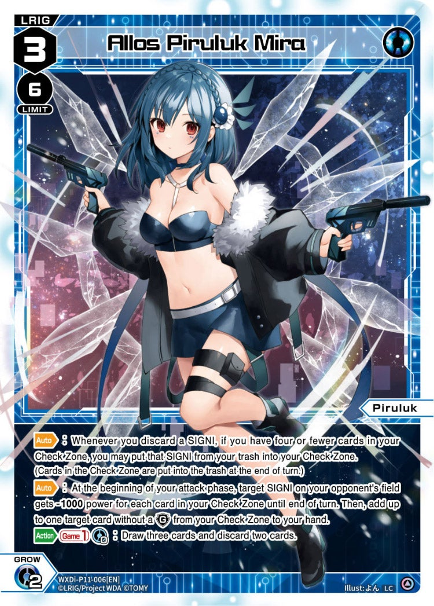

# Allos Piruluk Mira

## Thông tin lá

| Trường | Giá trị |
| --- | --- |
| Mã in | WXDi-P11-006[EN] |
| Set | WXDi-P11[EN] |
| Số thứ tự | 006 |
| Loại thẻ | LRIG |
| Vị trí | LRIG Deck |
| Số bản | — (set booster, không áp dụng) |
| Màu | Xanh dương |
| Độ hiếm | LC,LR,LRP,UR |
| Minh họa | よん |
| Level | 3 |
| Limit | 6 |
| Power | 0 |
| LRIG type / Class | Piruluk |
| Team / Master | — |
| Cost | — |
| Grow cost | 《U》×２ |
| Use timing | — |
| Life Burst | Không |

## Card text chính thức

[Auto]: Whenever you discard a SIGNI, if you have four or fewer cards in your Check Zone, you may put that SIGNI from your trash into your Check Zone.
(Cards in the Check Zone are put into the trash at the end of turn.)
[Auto]: At the beginning of your attack phase, target SIGNI on your opponent's field gets -1000 power for each card in your Check Zone until end of turn. Then, add up to one target card without a {Guard Icon} from your Check Zone to your hand.
[Action] {1/Game} {Bluex0}: Draw three cards and discard two cards.

## Power text / Life Burst

—

## Ghi chú minh họa
Artist: よん. Ảnh LC được tải từ Card List tiếng Anh.

## FAQ chính thức

**Q. What happens if a card is put into the Check zone?**
A. If you put a card into the Check zone with this effect, it remains in the Check zone until the end of that turn, and it is put into its owner's trash at the end of that turn. Please note that a card put into the Check zone does not trigger Life Burst.

**Q. When there are four cards in my Check zone, I used [Action] ability and discarded two SIGNI cards. May they both be put into my Check zone?**
A. No. You can only put one card. Discarding SIGNI cards triggers the [Auto] abilities for both, which in turn resolves. The number of cards in your Check zone becomes five when discarding the first card, so the second card cannot be put into your Check zone and it remains in your trash.

## Ảnh biến thể

- [LRP](../images/WXDi-P11-006P-EN.jpg)
- [LR](../images/WXDi-P11-006R-EN.jpg)
- [UR](../images/WXDi-P11-006U-EN.jpg)

## Nguồn
[Card List/FAQ chính thức](https://www.takaratomy.co.jp/products/en.wixoss/card/card.html?card_no=WXDi-P11-006%5BEN%5D ) · [Ảnh thẻ](https://www.takaratomy.co.jp/products/en.wixoss/card/thumb/WXDi-P11-006%5BEN%5D.jpg)
