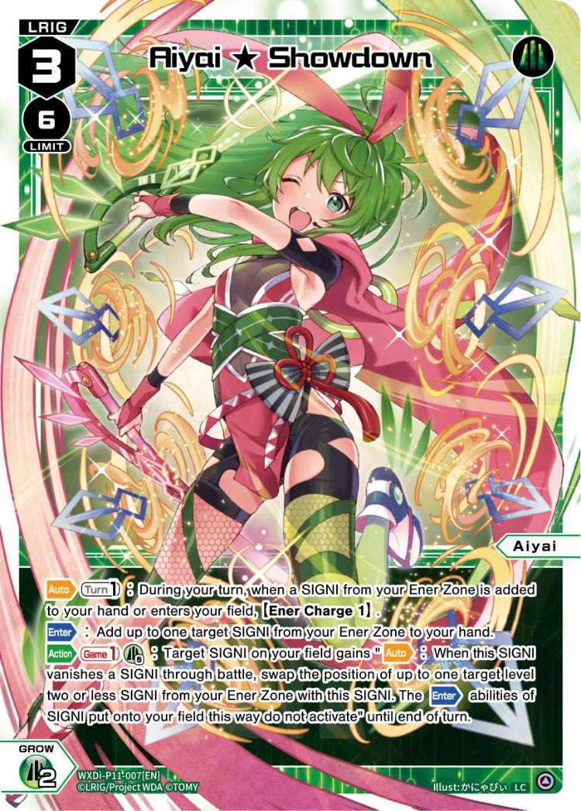

# Aiyai ★ Showdown

## Thông tin lá

| Trường | Giá trị |
| --- | --- |
| Mã in | WXDi-P11-007[EN] |
| Set | WXDi-P11[EN] |
| Số thứ tự | 007 |
| Loại thẻ | LRIG |
| Vị trí | LRIG Deck |
| Số bản | — (set booster, không áp dụng) |
| Màu | Xanh lá |
| Độ hiếm | LC,LR,LRP,UR |
| Minh họa | かにゃぴぃ |
| Level | 3 |
| Limit | 6 |
| Power | 0 |
| LRIG type / Class | Aiyai |
| Team / Master | — |
| Cost | — |
| Grow cost | 《G》×２ |
| Use timing | — |
| Life Burst | Không |

## Card text chính thức

[Auto] {1/Turn}: During your turn, when a SIGNI from your Ener Zone is added to your hand or enters your field, 【Ener Charge 1】.
[Enter]: Add up to one target SIGNI from your Ener Zone to your hand.
[Action] {1/Game} {Greenx0}: Target SIGNI on your field gains "[Auto]: When this SIGNI vanishes a SIGNI through battle, swap the position of up to one target level two or less SIGNI from your Ener Zone with this SIGNI. The [Enter] abilities of SIGNI put onto your field this way do not activate" until end of turn.

## Power text / Life Burst

—

## Ghi chú minh họa
Artist: かにゃぴぃ. Ảnh LC được tải từ Card List tiếng Anh.

## FAQ chính thức

**Q. If I swap the position of SIGNI on the field and the SIGNI in the Ener zone, is the SIGNI in the Ener zone put on the field with upped?**
A. Yes, if the SIGNI is just replaced and put on the field with no other effect, the SIGNI is put on the field with upped.

## Ảnh biến thể

- [LRP](../images/WXDi-P11-007P-EN.jpg)
- [LR](../images/WXDi-P11-007R-EN.jpg)
- [UR](../images/WXDi-P11-007U-EN.jpg)

## Nguồn
[Card List/FAQ chính thức](https://www.takaratomy.co.jp/products/en.wixoss/card/card.html?card_no=WXDi-P11-007%5BEN%5D ) · [Ảnh thẻ](https://www.takaratomy.co.jp/products/en.wixoss/card/thumb/WXDi-P11-007%5BEN%5D.jpg)
