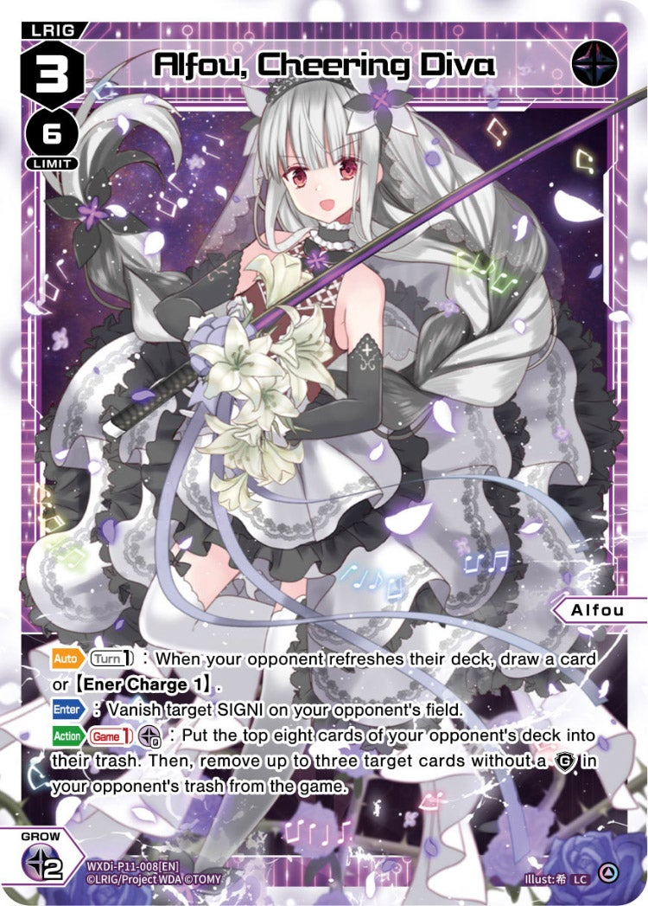

# Alfou, Cheering Diva

## Thông tin lá

| Trường | Giá trị |
| --- | --- |
| Mã in | WXDi-P11-008[EN] |
| Set | WXDi-P11[EN] |
| Số thứ tự | 008 |
| Loại thẻ | LRIG |
| Vị trí | LRIG Deck |
| Số bản | — (set booster, không áp dụng) |
| Màu | Đen |
| Độ hiếm | LC,LR,LRP,UR |
| Minh họa | 希 |
| Level | 3 |
| Limit | 6 |
| Power | 0 |
| LRIG type / Class | Alfou |
| Team / Master | — |
| Cost | — |
| Grow cost | 《B》×２ |
| Use timing | — |
| Life Burst | Không |

## Card text chính thức

[Auto] {1/Turn}: When your opponent refreshes their deck, draw a card or 【Ener Charge 1】.
[Enter]: Vanish target SIGNI on your opponent's field.
[Action] {1/Game} {Blackx0}: Put the top eight cards of your opponent's deck into their trash. Then, remove up to three target cards without a {Guard Icon} in your opponent's trash from the game.

## Power text / Life Burst

—

## Ghi chú minh họa
Artist: 希. Ảnh LC được tải từ Card List tiếng Anh.

## FAQ chính thức

**Q. I used [Action] ability when my opponent's deck has seven or less cards. What happens?**
A. All seven of them are put into their owner’s trash and the latter half of the effect is processed. After all of these effects are resolved, your opponent refresh their deck.

## Ảnh biến thể

- [LRP](../images/WXDi-P11-008P-EN.jpg)
- [LR](../images/WXDi-P11-008R-EN.jpg)
- [UR](../images/WXDi-P11-008U-EN.jpg)

## Nguồn
[Card List/FAQ chính thức](https://www.takaratomy.co.jp/products/en.wixoss/card/card.html?card_no=WXDi-P11-008%5BEN%5D ) · [Ảnh thẻ](https://www.takaratomy.co.jp/products/en.wixoss/card/thumb/WXDi-P11-008%5BEN%5D.jpg)
