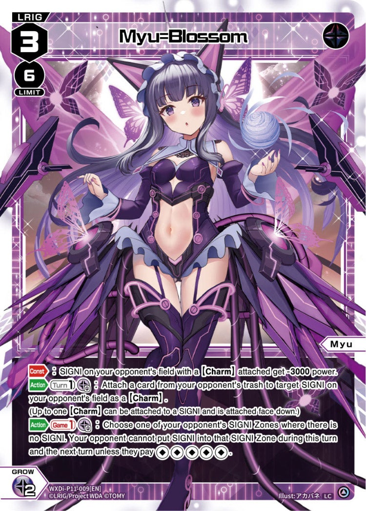

# Myu=Blossom

## Thông tin lá

| Trường | Giá trị |
| --- | --- |
| Mã in | WXDi-P11-009[EN] |
| Set | WXDi-P11[EN] |
| Số thứ tự | 009 |
| Loại thẻ | LRIG |
| Vị trí | LRIG Deck |
| Số bản | — (set booster, không áp dụng) |
| Màu | Đen |
| Độ hiếm | LC,LR,LRP,UR |
| Minh họa | アカバネ |
| Level | 3 |
| Limit | 6 |
| Power | 0 |
| LRIG type / Class | Myu |
| Team / Master | — |
| Cost | — |
| Grow cost | 《B》×２ |
| Use timing | — |
| Life Burst | Không |

## Card text chính thức

[Constant]: SIGNI on your opponent's field with a 【Charm】 attached get -3000 power.
[Action] {1/Turn} {Blackx0}: Attach a card from your opponent's trash to target SIGNI on your opponent's field as a 【Charm】.
(Up to one 【Charm】 can be attached to a SIGNI and is attached face down.)
[Action] {1/Game} {Blackx0}: Choose one of your opponent's SIGNI Zones where there is no SIGNI. Your opponent cannot put SIGNI into that SIGNI Zone during this turn and the next turn unless they pay {Colorless} {Colorless} {Colorless} {Colorless} {Colorless}.

## Power text / Life Burst

—

## Ghi chú minh họa
Artist: アカバネ. Ảnh LC được tải từ Card List tiếng Anh.

## FAQ chính thức

**Q. May I see the face of the attached [charm] card with SIGNI?**
A. Yes, any player can see it at any time. Previously, the rule was that no one could see the face, but that rule regarding [charms] has changed. However, please refrain from excessive checking, which can greatly affect the progress of the game.

**Q. There is 《Giroppon, Code: Labyrinth》 on my field, and no SIGNI in my opponent's SIGNI zone in front of it. What happens if I use the second [Action] ability to that SIGNI zone by 《Myu=Blossom》?**
A. When your opponent put SIGNI, your opponent must put it in front of 《Giroppon, Code: Labyrinth》 if possible, but your opponent must pay total five of {colorless} to put it, and effect of 《Giroppon, Code: Labyrinth》 does not always compel the Ener cost payment. As a result, your opponent can choose whether to pay total five of {colorless} to put it in front of 《Giroppon, Code: Labyrinth》 or on a different SIGNI zone.

## Ảnh biến thể

- [LRP](../images/WXDi-P11-009P-EN.jpg)
- [LR](../images/WXDi-P11-009R-EN.jpg)
- [UR](../images/WXDi-P11-009U-EN.jpg)

## Nguồn
[Card List/FAQ chính thức](https://www.takaratomy.co.jp/products/en.wixoss/card/card.html?card_no=WXDi-P11-009%5BEN%5D ) · [Ảnh thẻ](https://www.takaratomy.co.jp/products/en.wixoss/card/thumb/WXDi-P11-009%5BEN%5D.jpg)
