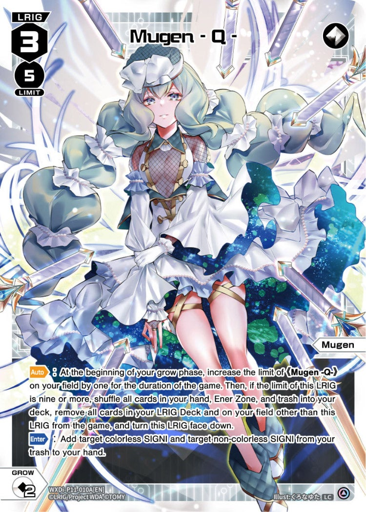

# Mugen -Q-

## Thông tin lá

| Trường | Giá trị |
| --- | --- |
| Mã in | WXDi-P11-010A[EN] |
| Set | WXDi-P11[EN] |
| Số thứ tự | 010A |
| Loại thẻ | LRIG |
| Vị trí | LRIG Deck |
| Số bản | — (set booster, không áp dụng) |
| Màu | Không màu |
| Độ hiếm | LC,LR |
| Minh họa | くろなゆた |
| Level | 3 |
| Limit | 5 |
| Power | 0 |
| LRIG type / Class | Mugen |
| Team / Master | — |
| Cost | — |
| Grow cost | 《C》×２ |
| Use timing | — |
| Life Burst | Không |

## Card text chính thức

[Auto]: At the beginning of your grow phase, increase the limit of 《Mugen -Q-》 on your field by one for the duration of the game. Then, if the limit of this LRIG is nine or more, shuffle all cards in your hand, Ener Zone, and trash into your deck, remove all cards in your LRIG Deck and on your field other than this LRIG from the game, and turn this LRIG face down.
[Enter]: Add target colorless SIGNI and target non-colorless SIGNI from your trash to your hand.

## Power text / Life Burst

—

## Ghi chú minh họa
Artist: くろなゆた. Ảnh LC được tải từ Card List tiếng Anh.

## FAQ chính thức

**Q. When I check the limit value of this LRIG  by the [Auto] ability,  does it include the limit +1 with the Assist LRIG?**
A. Yes, if the limit is increased by an Assist LRIG, you check to see if it is nine or more including that.

**Q. which cards are specifically removed about the effect "remove all cards in your LRIG Deck and on your field other then this LRIG from the game"?**
A. All cards in the LRIG deck, cards in the SIGNI zone, Assist LRIG and cards underneath this LRIG are removed from the game, leaving only this one LRIG in the centre LRIG.

## Ảnh biến thể

- [LR](../images/WXDi-P11-010AR-EN.jpg)

## Nguồn
[Card List/FAQ chính thức](https://www.takaratomy.co.jp/products/en.wixoss/card/card.html?card_no=WXDi-P11-010A%5BEN%5D ) · [Ảnh thẻ](https://www.takaratomy.co.jp/products/en.wixoss/card/thumb/WXDi-P11-010A%5BEN%5D.jpg)
