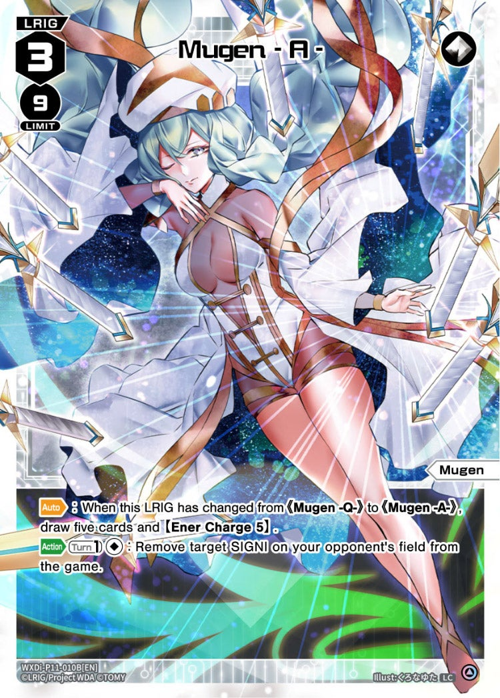

# Mugen -A-

## Thông tin lá

| Trường | Giá trị |
| --- | --- |
| Mã in | WXDi-P11-010B[EN] |
| Set | WXDi-P11[EN] |
| Số thứ tự | 010B |
| Loại thẻ | LRIG |
| Vị trí | LRIG Deck |
| Số bản | — (set booster, không áp dụng) |
| Màu | Không màu |
| Độ hiếm | LC,LRP,UR |
| Minh họa | くろなゆた |
| Level | 3 |
| Limit | 9 |
| Power | 0 |
| LRIG type / Class | Mugen |
| Team / Master | — |
| Cost | — |
| Grow cost | — |
| Use timing | — |
| Life Burst | Không |

## Card text chính thức

[Auto]: When this LRIG has changed from 《Mugen -Q-》 to 《Mugen -A》, draw five cards and 【Ener Charge 5】.
[Action] {1/Turn} {Colorless}: Remove target SIGNI on your opponent's field from the game.

## Power text / Life Burst

—

## Ghi chú minh họa
Artist: くろなゆた. Ảnh LC được tải từ Card List tiếng Anh.

## FAQ chính thức

— (không có FAQ riêng cho mã này trên trang FAQ tiếng Anh.)

## Ảnh biến thể

- [LRP](../images/WXDi-P11-010BP-EN.jpg)
- [UR](../images/WXDi-P11-010BU-EN.jpg)

## Nguồn
[Card List/FAQ chính thức](https://www.takaratomy.co.jp/products/en.wixoss/card/card.html?card_no=WXDi-P11-010B%5BEN%5D ) · [Ảnh thẻ](https://www.takaratomy.co.jp/products/en.wixoss/card/thumb/WXDi-P11-010B%5BEN%5D.jpg)
