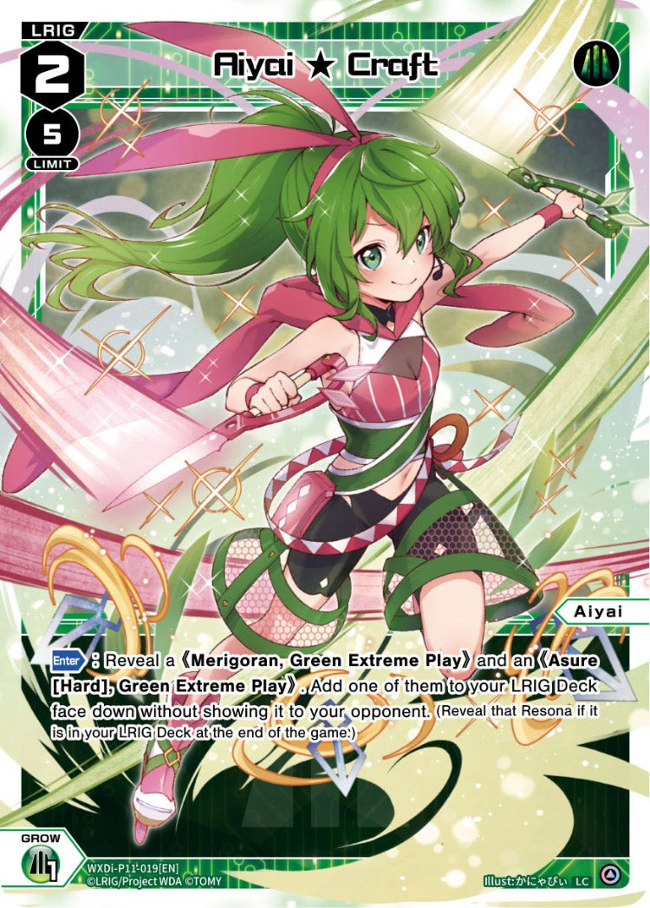

# Aiyai ★ Craft

## Thông tin lá

| Trường | Giá trị |
| --- | --- |
| Mã in | WXDi-P11-019[EN] |
| Set | WXDi-P11[EN] |
| Số thứ tự | 019 |
| Loại thẻ | LRIG |
| Vị trí | LRIG Deck |
| Số bản | — (set booster, không áp dụng) |
| Màu | Xanh lá |
| Độ hiếm | LC,LR |
| Minh họa | かにゃぴぃ |
| Level | 2 |
| Limit | 5 |
| Power | 0 |
| LRIG type / Class | Aiyai |
| Team / Master | — |
| Cost | — |
| Grow cost | 《G》×１ |
| Use timing | — |
| Life Burst | Không |

## Card text chính thức

[Enter]: Reveal a 《Merigoran, Green Extreme Play》 and an 《Asure [Hard], Green Extreme Play》. Add one of them to your LRIG Deck face down without showing it to your opponent. (Reveal that Resona if it is in your LRIG Deck at the end of the game.)

## Power text / Life Burst

—

## Ghi chú minh họa
Artist: かにゃぴぃ. Ảnh LC được tải từ Card List tiếng Anh.

## FAQ chính thức

**Q. After adding either 《Merigoran, Green Extreme Play》 or 《Asure [Hard], Green Extreme Play》 to my LRIG deck, what do I do with the other?**
A. The card you did not add it to the LRIG deck also do not have to disclose it to your opponent. Please make sure that your opponent does not know which one you have added.

## Ảnh biến thể

- [LR](../images/WXDi-P11-019R-EN.jpg)

## Nguồn
[Card List/FAQ chính thức](https://www.takaratomy.co.jp/products/en.wixoss/card/card.html?card_no=WXDi-P11-019%5BEN%5D ) · [Ảnh thẻ](https://www.takaratomy.co.jp/products/en.wixoss/card/thumb/WXDi-P11-019%5BEN%5D.jpg)
