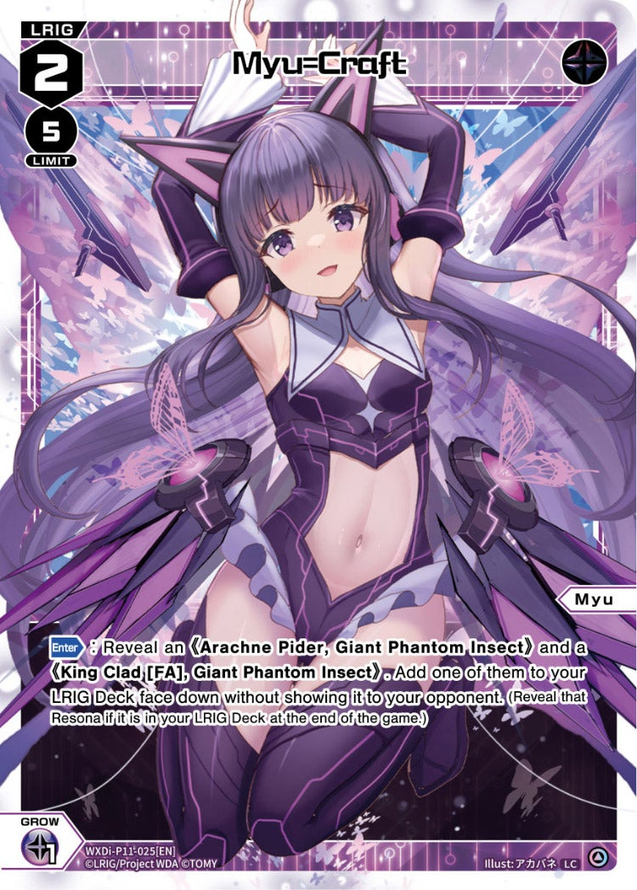

# Myu=Craft

## Thông tin lá

| Trường | Giá trị |
| --- | --- |
| Mã in | WXDi-P11-025[EN] |
| Set | WXDi-P11[EN] |
| Số thứ tự | 025 |
| Loại thẻ | LRIG |
| Vị trí | LRIG Deck |
| Số bản | — (set booster, không áp dụng) |
| Màu | Đen |
| Độ hiếm | LC,LR |
| Minh họa | アカバネ |
| Level | 2 |
| Limit | 5 |
| Power | 0 |
| LRIG type / Class | Myu |
| Team / Master | — |
| Cost | — |
| Grow cost | 《B》×１ |
| Use timing | — |
| Life Burst | Không |

## Card text chính thức

[Enter]: Reveal an 《Arachne Pider, Giant Phantom Insect》 and a 《King Clad [FA], Giant Phantom Insect》. Add one of them to your LRIG Deck face down without showing it to your opponent. (Reveal that Resona if it is in your LRIG Deck at the end of the game.)

## Power text / Life Burst

—

## Ghi chú minh họa
Artist: アカバネ. Ảnh LC được tải từ Card List tiếng Anh.

## FAQ chính thức

**Q. After adding either 《Arachne Pider, Giant Phantom Insect》 or 《King Clad [FA], Giant Phantom Insect》 to my LRIG deck, what do I do with the other?**
A. The card you did not add it to the LRIG deck also do not have to disclose it to your opponent. Please make sure that your opponent does not know which one you have added.

## Ảnh biến thể

- [LR](../images/WXDi-P11-025R-EN.jpg)

## Nguồn
[Card List/FAQ chính thức](https://www.takaratomy.co.jp/products/en.wixoss/card/card.html?card_no=WXDi-P11-025%5BEN%5D ) · [Ảnh thẻ](https://www.takaratomy.co.jp/products/en.wixoss/card/thumb/WXDi-P11-025%5BEN%5D.jpg)
