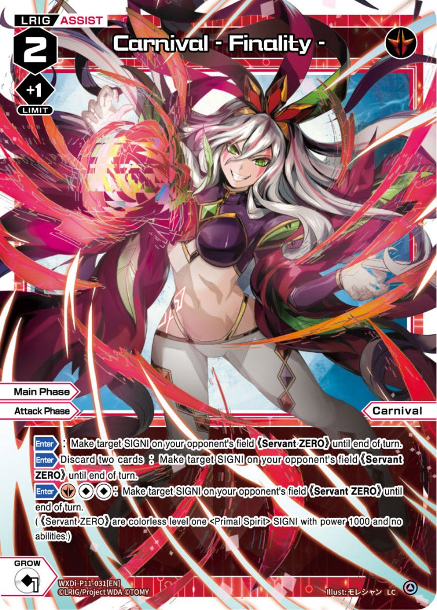

# Carnival -Finality-

## Thông tin lá

| Trường | Giá trị |
| --- | --- |
| Mã in | WXDi-P11-031[EN] |
| Set | WXDi-P11[EN] |
| Số thứ tự | 031 |
| Loại thẻ | ASSIST LRIG |
| Vị trí | LRIG Deck |
| Số bản | — (set booster, không áp dụng) |
| Màu | Đỏ |
| Độ hiếm | LC,LC(P) |
| Minh họa | モレシャン |
| Level | 2 |
| Limit | ＋１ |
| Power | 0 |
| LRIG type / Class | Carnival |
| Team / Master | — |
| Cost | — |
| Grow cost | 《C》×１ |
| Use timing | Main Phase
Attack Phase |
| Life Burst | Không |

## Card text chính thức

[Enter]: Make target SIGNI on your opponent's field 《Servant ZERO》 until end of turn.
[Enter] Discard two cards: Make target SIGNI on your opponent's field 《Servant ZERO》 until end of turn.
[Enter] {Red} {Colorless} {Colorless}: Make target SIGNI on your opponent's field 《Servant ZERO》 until end of turn.
(《Servant ZERO》 are colorless level one <Primal Spirit> SIGNI with power 1000 and no abilities.)

## Power text / Life Burst

—

## Ghi chú minh họa
Artist: モレシャン. Ảnh LC được tải từ Card List tiếng Anh.

## FAQ chính thức

**Q. Do effects that modify the power, increase or decrease the power, or grant abilities to the original SIGNI remain active when my opponent's SIGNI is made into 《Servant ZERO》?**
A. If a SIGNI on the field becomes another SIGNI, effects that modify the power, increase or decrease the power, or grant abilities are not applied.

**Q. If my SIGNI that is downed becomes a 《Servant ZERO》, does it become upped?**
A. No. It will remain downed. The state of the SIGNI that was originally on the field (upped, downed, frozen, etc.) remains the same.

## Ảnh biến thể

- [LC(P)](../images/WXDi-P11-031P-EN.jpg)

## Nguồn
[Card List/FAQ chính thức](https://www.takaratomy.co.jp/products/en.wixoss/card/card.html?card_no=WXDi-P11-031%5BEN%5D ) · [Ảnh thẻ](https://www.takaratomy.co.jp/products/en.wixoss/card/thumb/WXDi-P11-031%5BEN%5D.jpg)
