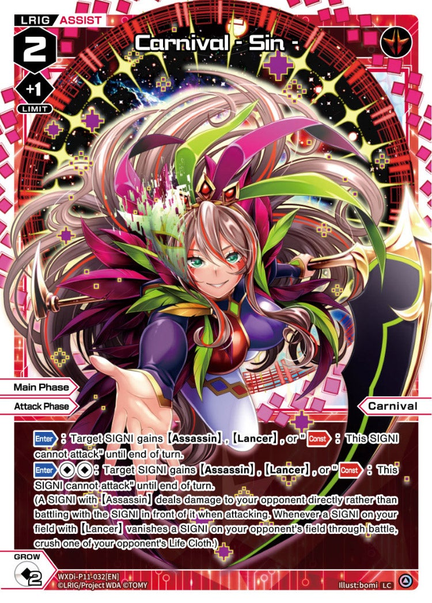

# Carnival -Sin-

## Thông tin lá

| Trường | Giá trị |
| --- | --- |
| Mã in | WXDi-P11-032[EN] |
| Set | WXDi-P11[EN] |
| Số thứ tự | 032 |
| Loại thẻ | ASSIST LRIG |
| Vị trí | LRIG Deck |
| Số bản | — (set booster, không áp dụng) |
| Màu | Đỏ |
| Độ hiếm | LC,LC(P) |
| Minh họa | bomi |
| Level | 2 |
| Limit | ＋１ |
| Power | 0 |
| LRIG type / Class | Carnival |
| Team / Master | — |
| Cost | — |
| Grow cost | 《C》×２ |
| Use timing | Main Phase / Attack Phase |
| Life Burst | Không |

## Card text chính thức

[Enter]: Target SIGNI gains 【Assassin】, 【Lancer】, or "[Constant]: This SIGNI cannot attack" until end of turn.
[Enter] {Colorless} {Colorless}: Target SIGNI gains 【Assassin】, 【Lancer】, or "[Constant]: This SIGNI cannot attack" until end of turn.
(A SIGNI with 【Assassin】 deals damage to your opponent directly rather than battling with the SIGNI in front of it when attacking. Whenever a SIGNI on your field with 【Lancer】 vanishes a SIGNI on your opponent's field through battle, crush one of your opponent's Life Cloth.)

## Power text / Life Burst

—

## Ghi chú minh họa
Artist: bomi. Ảnh LC được tải từ Card List tiếng Anh.

## FAQ chính thức

— (không có FAQ riêng cho mã này trên trang FAQ tiếng Anh.)

## Ảnh biến thể

- [LC(P)](../images/WXDi-P11-032P-EN.jpg)

## Nguồn
[Card List/FAQ chính thức](https://www.takaratomy.co.jp/products/en.wixoss/card/card.html?card_no=WXDi-P11-032%5BEN%5D ) · [Ảnh thẻ](https://www.takaratomy.co.jp/products/en.wixoss/card/thumb/WXDi-P11-032%5BEN%5D.jpg)
