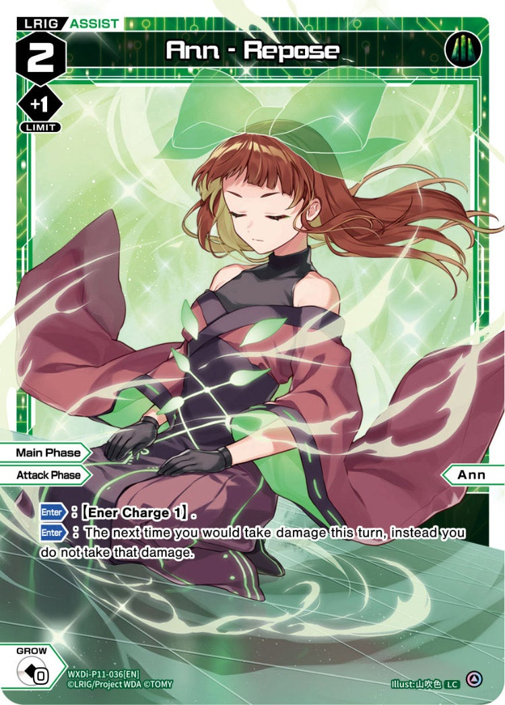

# Ann - Repose

## Thông tin lá

| Trường | Giá trị |
| --- | --- |
| Mã in | WXDi-P11-036[EN] |
| Set | WXDi-P11[EN] |
| Số thứ tự | 036 |
| Loại thẻ | ASSIST LRIG |
| Vị trí | LRIG Deck |
| Số bản | — (set booster, không áp dụng) |
| Màu | Xanh lá |
| Độ hiếm | LC,LC(P) |
| Minh họa | 山吹色 |
| Level | 2 |
| Limit | ＋１ |
| Power | 0 |
| LRIG type / Class | Ann |
| Team / Master | — |
| Cost | — |
| Grow cost | 《C》×０ |
| Use timing | Main Phase
Attack Phase |
| Life Burst | Không |

## Card text chính thức

[Enter]: 【Ener Charge 1】.
[Enter]: The next time you would take damage this turn, instead you do not take that damage.

## Power text / Life Burst

—

## Ghi chú minh họa
Artist: 山吹色. Ảnh LC được tải từ Card List tiếng Anh.

## FAQ chính thức

**Q. After triggering the second [Enter] ability, my opponent's SIGNI with [Double Crush] attacked. How many of my Life Cloth are crushed?**
A. Crushed Life Cloth is zero. [Double Crush] is an effect that crushes two Life Cloth instead of one when deal damage by an attack, but this [Enter] ability prevents damage, so not one Life Cloth is crushed.

## Ảnh biến thể

- [LC(P)](../images/WXDi-P11-036P-EN.jpg)

## Nguồn
[Card List/FAQ chính thức](https://www.takaratomy.co.jp/products/en.wixoss/card/card.html?card_no=WXDi-P11-036%5BEN%5D ) · [Ảnh thẻ](https://www.takaratomy.co.jp/products/en.wixoss/card/thumb/WXDi-P11-036%5BEN%5D.jpg)
