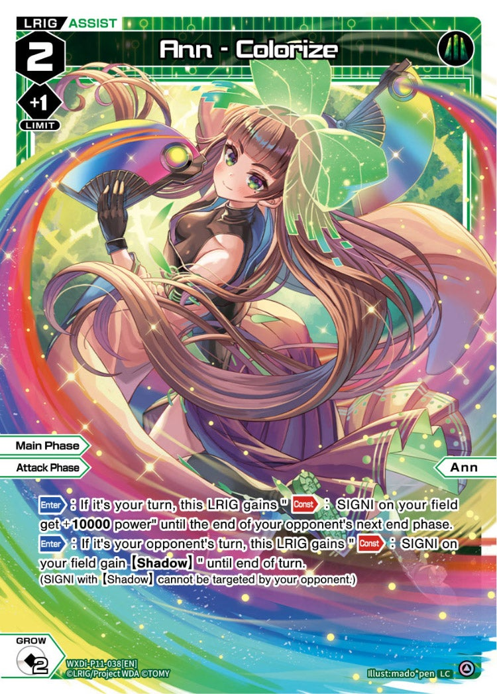

# Ann - Colorize

## Thông tin lá

| Trường | Giá trị |
| --- | --- |
| Mã in | WXDi-P11-038[EN] |
| Set | WXDi-P11[EN] |
| Số thứ tự | 038 |
| Loại thẻ | ASSIST LRIG |
| Vị trí | LRIG Deck |
| Số bản | — (set booster, không áp dụng) |
| Màu | Xanh lá |
| Độ hiếm | LC,LC(P) |
| Minh họa | mado*pen |
| Level | 2 |
| Limit | ＋１ |
| Power | 0 |
| LRIG type / Class | Ann |
| Team / Master | — |
| Cost | — |
| Grow cost | 《C》×２ |
| Use timing | Main Phase / Attack Phase |
| Life Burst | Không |

## Card text chính thức

[Enter]: If it's your turn, this LRIG gains "[Constant]: SIGNI on your field get +10000 power" until the end of your opponent's next end phase.
[Enter]: If it's your opponent's turn, this LRIG gains "[Constant]: SIGNI on your field gain 【Shadow】" until end of turn.
(SIGNI with 【Shadow】 cannot be targeted by your opponent.)

## Power text / Life Burst

—

## Ghi chú minh họa
Artist: mado*pen. Ảnh LC được tải từ Card List tiếng Anh.

## FAQ chính thức

**Q. After triggering this [Enter] ability, does SIGNI that put on the field later in the same turn gets +10000 or gains [Shadow]?**
A. Yes, this LRIG's effect of [Const] ability will affect your SIGNI. It also gets +10000 power to any SIGNI that put on the field later in the same turn if it is your turn, and gets [Shadow] if it is your opponent's turn.

## Ảnh biến thể

- [LC(P)](../images/WXDi-P11-038P-EN.jpg)

## Nguồn
[Card List/FAQ chính thức](https://www.takaratomy.co.jp/products/en.wixoss/card/card.html?card_no=WXDi-P11-038%5BEN%5D ) · [Ảnh thẻ](https://www.takaratomy.co.jp/products/en.wixoss/card/thumb/WXDi-P11-038%5BEN%5D.jpg)
