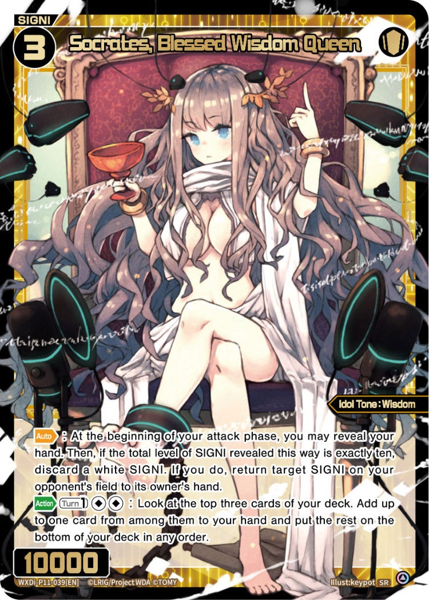

# Socrates, Blessed Mind Queen

## Thông tin lá

| Trường | Giá trị |
| --- | --- |
| Mã in | WXDi-P11-039[EN] |
| Set | WXDi-P11[EN] |
| Số thứ tự | 039 |
| Loại thẻ | SIGNI |
| Vị trí | Main Deck |
| Số bản | — (set booster, không áp dụng) |
| Màu | Trắng |
| Độ hiếm | SR,SRP |
| Minh họa | keypot |
| Level | 3 |
| Limit | — |
| Power | 10000 |
| LRIG type / Class | Idol Tone：Wisdom |
| Team / Master | — |
| Cost | — |
| Grow cost | — |
| Use timing | — |
| Life Burst | Không |

## Card text chính thức

[Auto]: At the beginning of your attack phase, you may reveal your hand. Then, if the total level of SIGNI revealed this way is exactly ten, discard a white SIGNI. If you do, return target SIGNI on your opponent's field to its owner's hand.
[Action] {1/Turn} {Colorless} {Colorless}: Look at the top three cards of your deck. Add up to one card from among them to your hand and put the rest on the bottom of your deck in any order.

## Power text / Life Burst

—

## Ghi chú minh họa
Artist: keypot. Ảnh SR được tải từ Card List tiếng Anh.

## FAQ chính thức

**Q. Does the [Auto] ability reveal all the cards in my hand? Or may I choose to reveal some of them?**
A. If you choose to reveal, you reveal all cards in your hand. You cannot choose not to reveal only some of them.

## Ảnh biến thể

- [SRP](../images/WXDi-P11-039P-EN.jpg)

## Nguồn
[Card List/FAQ chính thức](https://www.takaratomy.co.jp/products/en.wixoss/card/card.html?card_no=WXDi-P11-039%5BEN%5D ) · [Ảnh thẻ](https://www.takaratomy.co.jp/products/en.wixoss/card/thumb/WXDi-P11-039%5BEN%5D.jpg)
