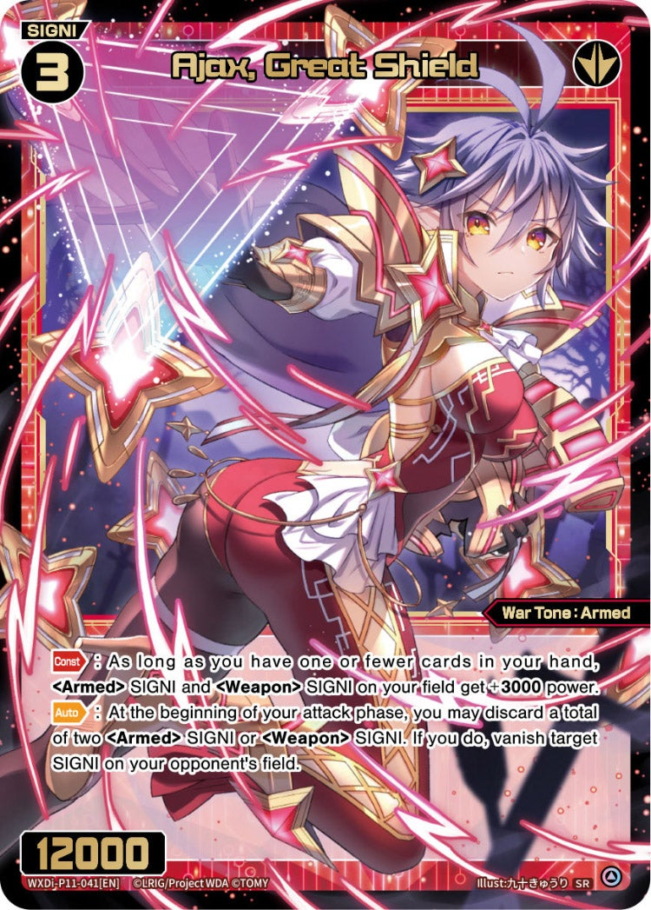

# Ajax, Great Shield

## Thông tin lá

| Trường | Giá trị |
| --- | --- |
| Mã in | WXDi-P11-041[EN] |
| Set | WXDi-P11[EN] |
| Số thứ tự | 041 |
| Loại thẻ | SIGNI |
| Vị trí | Main Deck |
| Số bản | — (set booster, không áp dụng) |
| Màu | Đỏ |
| Độ hiếm | SR,SRP |
| Minh họa | 九十きゅうり |
| Level | 3 |
| Limit | — |
| Power | 12000 |
| LRIG type / Class | War Tone：Armed |
| Team / Master | — |
| Cost | — |
| Grow cost | — |
| Use timing | — |
| Life Burst | Không |

## Card text chính thức

[Constant]: As long as you have one or fewer cards in your hand, <Armed> SIGNI and <Weapon> SIGNI on your field get +3000 power.
[Auto]: At the beginning of your attack phase, you may discard a total of two <Armed> SIGNI or <Weapon> SIGNI. If you do, vanish target SIGNI on your opponent's field.

## Power text / Life Burst

—

## Ghi chú minh họa
Artist: 九十きゅうり. Ảnh SR được tải từ Card List tiếng Anh.

## FAQ chính thức

**Q. Can I discard two <Armed> cards from my hand by the [Auto] ability?**
A. Yes, you can. You can discatd one <Armed> and one <Weapon>, or two of either.

## Ảnh biến thể

- [SRP](../images/WXDi-P11-041P-EN.jpg)

## Nguồn
[Card List/FAQ chính thức](https://www.takaratomy.co.jp/products/en.wixoss/card/card.html?card_no=WXDi-P11-041%5BEN%5D ) · [Ảnh thẻ](https://www.takaratomy.co.jp/products/en.wixoss/card/thumb/WXDi-P11-041%5BEN%5D.jpg)
