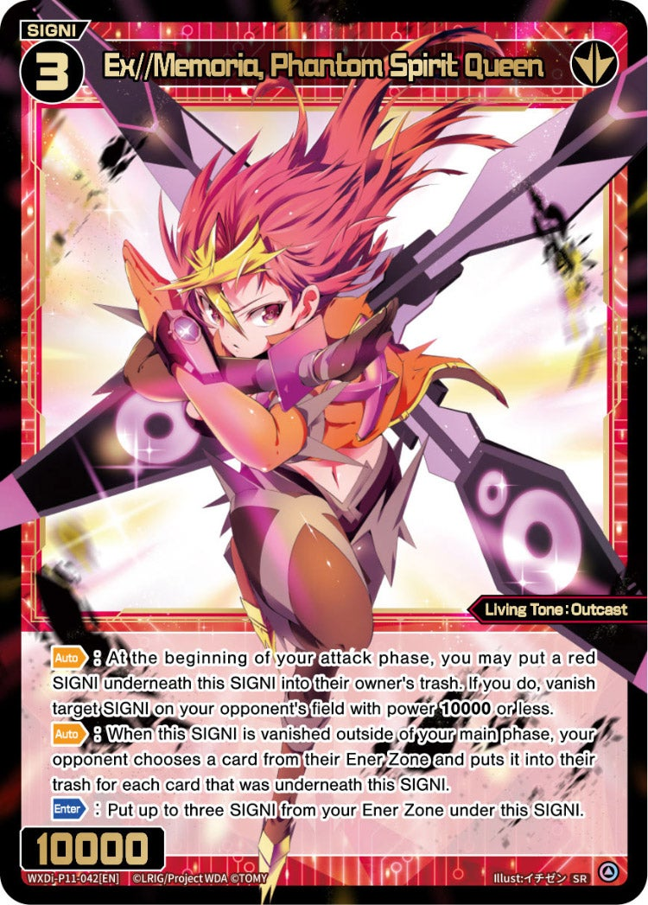

# Ex//Memoria, Phantom Spirit Queen

## Thông tin lá

| Trường | Giá trị |
| --- | --- |
| Mã in | WXDi-P11-042[EN] |
| Set | WXDi-P11[EN] |
| Số thứ tự | 042 |
| Loại thẻ | SIGNI |
| Vị trí | Main Deck |
| Số bản | — (set booster, không áp dụng) |
| Màu | Đỏ |
| Độ hiếm | SR,SRP |
| Minh họa | イチゼン |
| Level | 3 |
| Limit | — |
| Power | 10000 |
| LRIG type / Class | Living Tone：Outcast |
| Team / Master | — |
| Cost | — |
| Grow cost | — |
| Use timing | — |
| Life Burst | Không |

## Card text chính thức

[Auto]: At the beginning of your attack phase, you may put a red SIGNI underneath this SIGNI into their owner's trash. If you do, vanish target SIGNI on your opponent's field with power 10000 or less.
[Auto]: When this SIGNI is vanished outside of your main phase, your opponent chooses a card from their Ener Zone and puts it into their trash for each card that was underneath this SIGNI.
[Enter]: Put up to three SIGNI from your Ener Zone under this SIGNI.

## Power text / Life Burst

—

## Ghi chú minh họa
Artist: イチゼン. Ảnh SR được tải từ Card List tiếng Anh.

## FAQ chính thức

**Q. At what point in time exactly is the second [Auto] ability with "card that was underneath this SIGNI" referring specifically to the card that was underneath this SIGNI?**
A. It will be the card that was underneath just before this SIGNI was vanished. For example, if the [Enter] ability placed three cards in the under of that card and the first [Auto] ability placed one card in its owner's trash, the cards that were underneath will be two if when the card is vanished.

## Ảnh biến thể

- [SRP](../images/WXDi-P11-042P-EN.jpg)

## Nguồn
[Card List/FAQ chính thức](https://www.takaratomy.co.jp/products/en.wixoss/card/card.html?card_no=WXDi-P11-042%5BEN%5D ) · [Ảnh thẻ](https://www.takaratomy.co.jp/products/en.wixoss/card/thumb/WXDi-P11-042%5BEN%5D.jpg)
