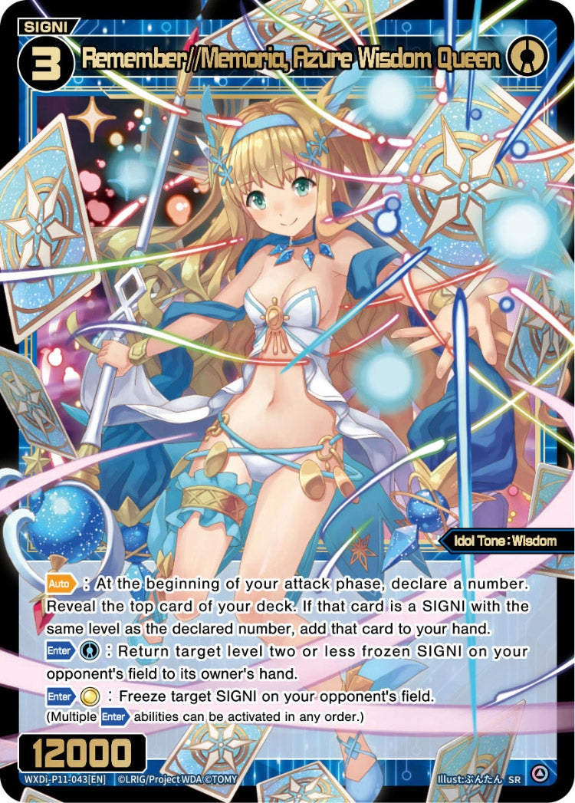

# Remember//Memoria, Azure Mind Queen

## Thông tin lá

| Trường | Giá trị |
| --- | --- |
| Mã in | WXDi-P11-043[EN] |
| Set | WXDi-P11[EN] |
| Số thứ tự | 043 |
| Loại thẻ | SIGNI |
| Vị trí | Main Deck |
| Số bản | — (set booster, không áp dụng) |
| Màu | Xanh dương |
| Độ hiếm | SR,SRP |
| Minh họa | ぶんたん |
| Level | 3 |
| Limit | — |
| Power | 12000 |
| LRIG type / Class | Idol Tone：Wisdom |
| Team / Master | — |
| Cost | — |
| Grow cost | — |
| Use timing | — |
| Life Burst | Không |

## Card text chính thức

[Auto]: At the beginning of your attack phase, declare a number. Reveal the top card of your deck. If that card is a SIGNI with the same level as the declared number, add that card to your hand.
[Enter] {Blue}: Return target level two or less frozen SIGNI on your opponent's field to its owner's hand.
[Enter] {Coin Icon}: Freeze target SIGNI on your opponent's field.
(Multiple [Enter] abilities can be activated in any order.)

## Power text / Life Burst

—

## Ghi chú minh họa
Artist: ぶんたん. Ảnh SR được tải từ Card List tiếng Anh.

## FAQ chính thức

**Q. Can I freeze my opponent's SIGNI by the second [Enter] ability and then resolve the first [Enter] ability to return it to my hand?**
A. Yes you can, as long as it is level two or less SIGNI. Multiple [Enter] abilities are triggered individually when they are put on the field and can be triggered in any order. The target is chosen at the time of each triggering.

## Ảnh biến thể

- [SRP](../images/WXDi-P11-043P-EN.jpg)

## Nguồn
[Card List/FAQ chính thức](https://www.takaratomy.co.jp/products/en.wixoss/card/card.html?card_no=WXDi-P11-043%5BEN%5D ) · [Ảnh thẻ](https://www.takaratomy.co.jp/products/en.wixoss/card/thumb/WXDi-P11-043%5BEN%5D.jpg)
