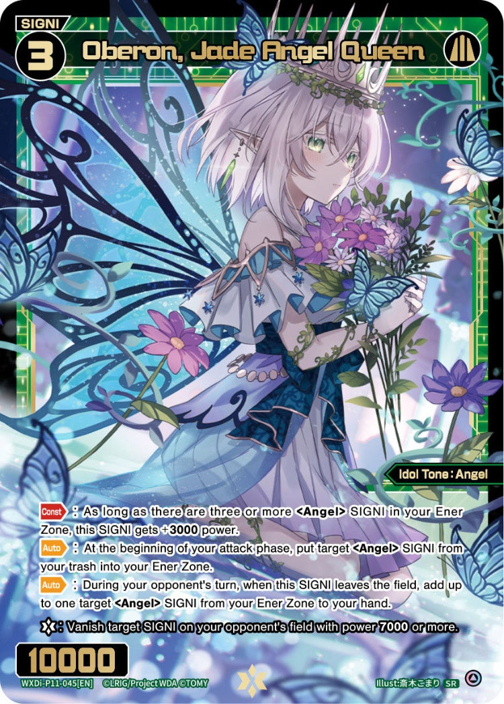

# Oberon, Jade Angel Queen

## Thông tin lá

| Trường | Giá trị |
| --- | --- |
| Mã in | WXDi-P11-045[EN] |
| Set | WXDi-P11[EN] |
| Số thứ tự | 045 |
| Loại thẻ | SIGNI |
| Vị trí | Main Deck |
| Số bản | — (set booster, không áp dụng) |
| Màu | Xanh lá |
| Độ hiếm | SR,SRP |
| Minh họa | 斎木こまり |
| Level | 3 |
| Limit | — |
| Power | 10000 |
| LRIG type / Class | Idol Tone：Angel |
| Team / Master | — |
| Cost | — |
| Grow cost | — |
| Use timing | — |
| Life Burst | Có |

## Card text chính thức

[Constant]: As long as there are three or more <Angel> SIGNI in your Ener Zone, this SIGNI gets +3000 power.
[Auto]: At the beginning of your attack phase, put target <Angel> SIGNI from your trash into your Ener Zone.
[Auto]: During your opponent's turn, when this SIGNI leaves the field, add up to one target <Angel> SIGNI from your Ener Zone to your hand.

## Power text / Life Burst

Vanish target SIGNI on your opponent's field with power 7000 or more.

## Ghi chú minh họa
Artist: 斎木こまり. Ảnh SR được tải từ Card List tiếng Anh.

## FAQ chính thức

**Q. When this SIGNI is vanished, may the second [Auto] ability add this SIGNI in my Ener zone to my hand?**
A. Yes, since this [Auto] ability is triggered after being vanished and put in your Ener zone, you can also select this SIGNI, an <Angel> SIGNI in your Ener zone, to add to your hand.

## Ảnh biến thể

- [SRP](../images/WXDi-P11-045P-EN.jpg)

## Nguồn
[Card List/FAQ chính thức](https://www.takaratomy.co.jp/products/en.wixoss/card/card.html?card_no=WXDi-P11-045%5BEN%5D ) · [Ảnh thẻ](https://www.takaratomy.co.jp/products/en.wixoss/card/thumb/WXDi-P11-045%5BEN%5D.jpg)
