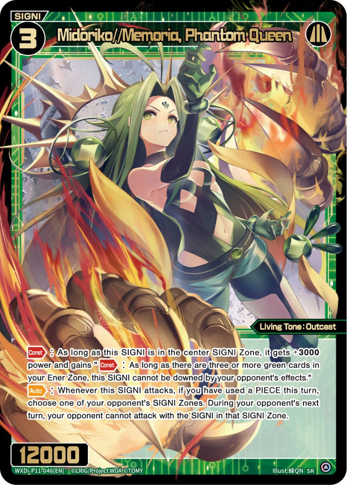

# Midoriko//Memoria, Phantom Queen

## Thông tin lá

| Trường | Giá trị |
| --- | --- |
| Mã in | WXDi-P11-046[EN] |
| Set | WXDi-P11[EN] |
| Số thứ tự | 046 |
| Loại thẻ | SIGNI |
| Vị trí | Main Deck |
| Số bản | — (set booster, không áp dụng) |
| Màu | Xanh lá |
| Độ hiếm | SR,SRP |
| Minh họa | 緑QN |
| Level | 3 |
| Limit | — |
| Power | 12000 |
| LRIG type / Class | Living Tone：Outcast |
| Team / Master | — |
| Cost | — |
| Grow cost | — |
| Use timing | — |
| Life Burst | Không |

## Card text chính thức

[Constant]: As long as this SIGNI is in the center SIGNI Zone, it gets +3000 power and gains "[Constant]: As long as there are three or more green cards in your Ener Zone, this SIGNI cannot be downed by your opponent's effects."
[Auto]: Whenever this SIGNI attacks, if you have used a PIECE this turn, choose one of your opponent's SIGNI Zones. During your opponent's next turn, your opponent cannot attack with the SIGNI in that SIGNI Zone.

## Power text / Life Burst

—

## Ghi chú minh họa
Artist: 緑QN. Ảnh SR được tải từ Card List tiếng Anh.

## FAQ chính thức

**Q. Can I count  《Servant #》 in the Ener zone as a green card?**
A. No, [Multi Ener] simply allows you to pay for Ener costs with it as if it is green, but the card 《Servant #》 with [Multi Ener] itself is colorless.

## Ảnh biến thể

- [SRP](../images/WXDi-P11-046P-EN.jpg)

## Nguồn
[Card List/FAQ chính thức](https://www.takaratomy.co.jp/products/en.wixoss/card/card.html?card_no=WXDi-P11-046%5BEN%5D ) · [Ảnh thẻ](https://www.takaratomy.co.jp/products/en.wixoss/card/thumb/WXDi-P11-046%5BEN%5D.jpg)
