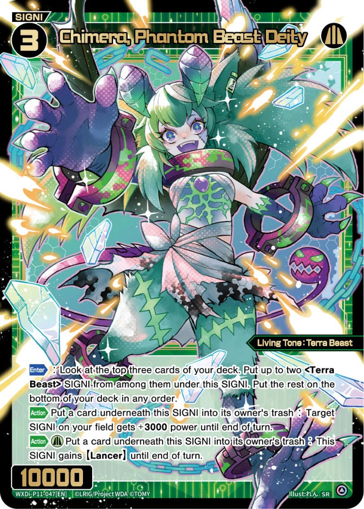

# Chimera, Phantom Beast Deity

## Thông tin lá

| Trường | Giá trị |
| --- | --- |
| Mã in | WXDi-P11-047[EN] |
| Set | WXDi-P11[EN] |
| Số thứ tự | 047 |
| Loại thẻ | SIGNI |
| Vị trí | Main Deck |
| Số bản | — (set booster, không áp dụng) |
| Màu | Xanh lá |
| Độ hiếm | SR,SRP |
| Minh họa | れん |
| Level | 3 |
| Limit | — |
| Power | 10000 |
| LRIG type / Class | Living Tone：Terra Beast |
| Team / Master | — |
| Cost | — |
| Grow cost | — |
| Use timing | — |
| Life Burst | Không |

## Card text chính thức

[Enter]: Look at the top three cards of your deck. Put up to two <Terra Beast> SIGNI from among them under this SIGNI. Put the rest on the bottom of your deck in any order.
[Action] Put a card underneath this SIGNI into its owner's trash: Target SIGNI on your field gets +3000 power until end of turn.
[Action] {Green} Put a card underneath this SIGNI into its owner's trash: This SIGNI gains 【Lancer】 until end of turn.

## Power text / Life Burst

—

## Ghi chú minh họa
Artist: れん. Ảnh SR được tải từ Card List tiếng Anh.

## FAQ chính thức

**Q. Is the card placed under this SIGNI by the [Enter] ability face up?**
A. Yes, unless otherwise stated, cards place under SIGNI are placed face up.

## Ảnh biến thể

- [SRP](../images/WXDi-P11-047P-EN.jpg)

## Nguồn
[Card List/FAQ chính thức](https://www.takaratomy.co.jp/products/en.wixoss/card/card.html?card_no=WXDi-P11-047%5BEN%5D ) · [Ảnh thẻ](https://www.takaratomy.co.jp/products/en.wixoss/card/thumb/WXDi-P11-047%5BEN%5D.jpg)
