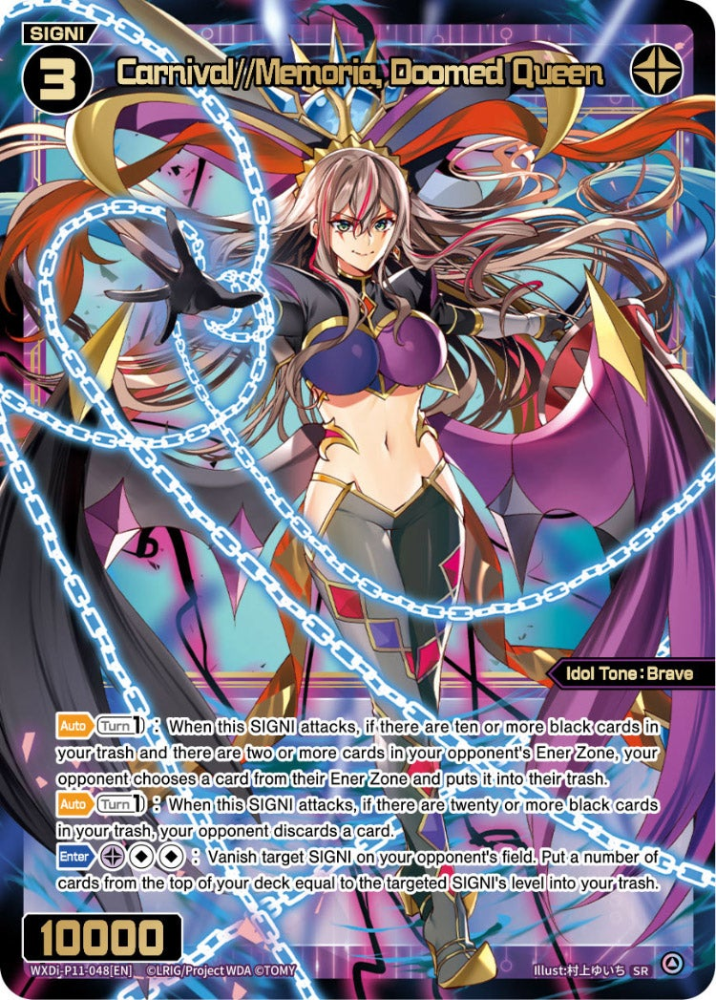

# Carnival//Memoria, Doomed Queen

## Thông tin lá

| Trường | Giá trị |
| --- | --- |
| Mã in | WXDi-P11-048[EN] |
| Set | WXDi-P11[EN] |
| Số thứ tự | 048 |
| Loại thẻ | SIGNI |
| Vị trí | Main Deck |
| Số bản | — (set booster, không áp dụng) |
| Màu | Đen |
| Độ hiếm | SR,SRP |
| Minh họa | 村上ゆいち |
| Level | 3 |
| Limit | — |
| Power | 10000 |
| LRIG type / Class | Idol Tone：Brave |
| Team / Master | — |
| Cost | — |
| Grow cost | — |
| Use timing | — |
| Life Burst | Không |

## Card text chính thức

[Auto] {1/Turn}: When this SIGNI attacks, if there are ten or more black cards in your trash and there are two or more cards in your opponent's Ener Zone, your opponent chooses a card from their Ener Zone and puts it into their trash.
[Auto] {1/Turn}: When this SIGNI attacks, if there are twenty or more black cards in your trash, your opponent discards a card.
[Enter] {Black} {Colorless} {Colorless}: Vanish target SIGNI on your opponent's field. Put a number of cards from the top of your deck equal to the targeted SIGNI's level into your trash.

## Power text / Life Burst

—

## Ghi chú minh họa
Artist: 村上ゆいち. Ảnh SR được tải từ Card List tiếng Anh.

## FAQ chính thức

**Q. Can I count  《Servant #》 in the Ener zone as a black card?**
A. No, [Multi Ener] simply allows you to pay for Ener costs with it as if it is black, but the card 《Servant #》 with [Multi Ener] itself is colorless.

## Ảnh biến thể

- [SRP](../images/WXDi-P11-048P-EN.jpg)

## Nguồn
[Card List/FAQ chính thức](https://www.takaratomy.co.jp/products/en.wixoss/card/card.html?card_no=WXDi-P11-048%5BEN%5D ) · [Ảnh thẻ](https://www.takaratomy.co.jp/products/en.wixoss/card/thumb/WXDi-P11-048%5BEN%5D.jpg)
