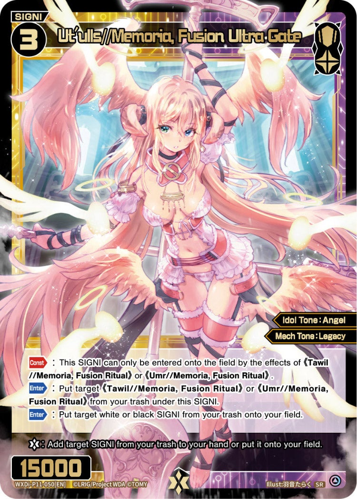

# Ut'ulls//Memoria, Fusion Ultra Gate

## Thông tin lá

| Trường | Giá trị |
| --- | --- |
| Mã in | WXDi-P11-050[EN] |
| Set | WXDi-P11[EN] |
| Số thứ tự | 050 |
| Loại thẻ | SIGNI |
| Vị trí | Main Deck |
| Số bản | — (set booster, không áp dụng) |
| Màu | Trắng / đen |
| Độ hiếm | SR,SRP |
| Minh họa | 羽音たらく |
| Level | 3 |
| Limit | — |
| Power | 15000 |
| LRIG type / Class | Idol Tone：Angel/Mech Tone：Legacy |
| Team / Master | — |
| Cost | — |
| Grow cost | — |
| Use timing | — |
| Life Burst | Có |

## Card text chính thức

[Constant]: This SIGNI can only be entered onto the field by the effects of 《Tawil//Memoria, Fusion Ritual》 or 《Umr//Memoria, Fusion Ritual》.
[Enter]: Put target 《Tawil//Memoria, Fusion Ritual》 or 《Umr//Memoria, Fusion Ritual》 from your trash under this SIGNI.
[Enter]: Put target white or black SIGNI from your trash onto your field.

## Power text / Life Burst

Add target SIGNI from your trash to your hand or put it onto your field.

## Ghi chú minh họa
Artist: 羽音たらく. Ảnh SR được tải từ Card List tiếng Anh.

## FAQ chính thức

**Q. Can I put this SIGNI in my Ener zone at the Ener charge?**
A. Yes, you can.

## Ảnh biến thể

- [SRP](../images/WXDi-P11-050P-EN.jpg)

## Nguồn
[Card List/FAQ chính thức](https://www.takaratomy.co.jp/products/en.wixoss/card/card.html?card_no=WXDi-P11-050%5BEN%5D ) · [Ảnh thẻ](https://www.takaratomy.co.jp/products/en.wixoss/card/thumb/WXDi-P11-050%5BEN%5D.jpg)
