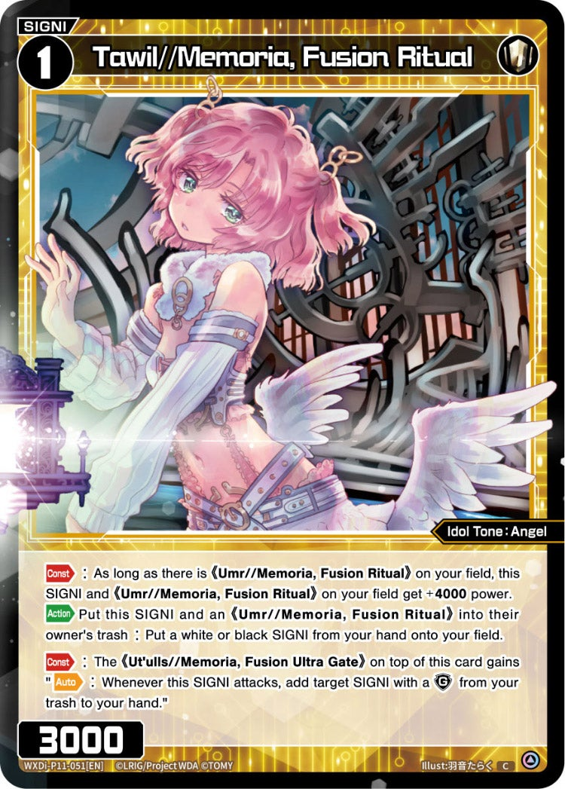

# Tawil//Memoria, Fusion Ritual

## Thông tin lá

| Trường | Giá trị |
| --- | --- |
| Mã in | WXDi-P11-051[EN] |
| Set | WXDi-P11[EN] |
| Số thứ tự | 051 |
| Loại thẻ | SIGNI |
| Vị trí | Main Deck |
| Số bản | — (set booster, không áp dụng) |
| Màu | Trắng |
| Độ hiếm | C,C(P) |
| Minh họa | 羽音たらく |
| Level | 1 |
| Limit | — |
| Power | 3000 |
| LRIG type / Class | Idol Tone：Angel |
| Team / Master | — |
| Cost | — |
| Grow cost | — |
| Use timing | — |
| Life Burst | Không |

## Card text chính thức

[Constant]: As long as there is 《Umr//Memoria, Fusion Ritual》 on your field, this SIGNI and 《Umr//Memoria, Fusion Ritual》 on your field get +4000 power.
[Action] Put this SIGNI and an 《Umr//Memoria, Fusion Ritual》 into their owner's trash: Put a white or black SIGNI from your hand onto your field.

[Constant]: The 《Ut'ulls//Memoria, Fusion Ultra Gate》 on top of this card gains "[Auto]: Whenever this SIGNI attacks, add target SIGNI with a {Guard Icon} from your trash to your hand."

## Power text / Life Burst

—

## Ghi chú minh họa
Artist: 羽音たらく. Ảnh C được tải từ Card List tiếng Anh.

## FAQ chính thức

**Q. Can I put 《Umr//Memoria, Fusion Ritual》 underneath SIGNI on my field into its owner's trash as a cost of [Action] ability?**
A. No, you cannot put it. The cost of [Action] ability can be paid for the 《Umr//Memoria, Fusion Ritual》 that has been put on the field as SIGNI. If it is placed underneath SIGNI or attached as [Charm], it cannot be used as the cost of that [Action] ability.

## Ảnh biến thể

- [C(P)](../images/WXDi-P11-051P-EN.jpg)

## Nguồn
[Card List/FAQ chính thức](https://www.takaratomy.co.jp/products/en.wixoss/card/card.html?card_no=WXDi-P11-051%5BEN%5D ) · [Ảnh thẻ](https://www.takaratomy.co.jp/products/en.wixoss/card/thumb/WXDi-P11-051%5BEN%5D.jpg)
