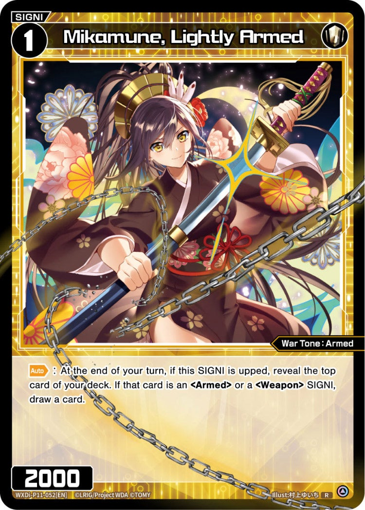

# Mikamune, Lightly Armed

## Thông tin lá

| Trường | Giá trị |
| --- | --- |
| Mã in | WXDi-P11-052[EN] |
| Set | WXDi-P11[EN] |
| Số thứ tự | 052 |
| Loại thẻ | SIGNI |
| Vị trí | Main Deck |
| Số bản | — (set booster, không áp dụng) |
| Màu | Trắng |
| Độ hiếm | R,R(P) |
| Minh họa | 村上ゆいち |
| Level | 1 |
| Limit | — |
| Power | 2000 |
| LRIG type / Class | War Tone：Armed |
| Team / Master | — |
| Cost | — |
| Grow cost | — |
| Use timing | — |
| Life Burst | Không |

## Card text chính thức

[Auto]: At the end of your turn, if this SIGNI is upped, reveal the top card of your deck. If that card is an <Armed> or a <Weapon> SIGNI, draw a card.

## Power text / Life Burst

—

## Ghi chú minh họa
Artist: 村上ゆいち. Ảnh R được tải từ Card List tiếng Anh.

## FAQ chính thức

**Q. If there are this SIGNI with downed and 《Exia, Blessed Angel Queen》 in my field, can I trigger this SIGNI's [Auto] ability?**
A. Yes, you can. 《Exia, Blessed Angel Queen》 with the ability of "[Auto]: At the end of your turn, up all SIGNI on your field." and this [Auto] ability are both triggered at the end of the turn, so if you resolve from 《Exia, Blessed Angel Queen》 first, that SIGNI will be up and that SIGNI's [Auto] ability can be resolved.

## Ảnh biến thể

- [R(P)](../images/WXDi-P11-052P-EN.jpg)

## Nguồn
[Card List/FAQ chính thức](https://www.takaratomy.co.jp/products/en.wixoss/card/card.html?card_no=WXDi-P11-052%5BEN%5D ) · [Ảnh thẻ](https://www.takaratomy.co.jp/products/en.wixoss/card/thumb/WXDi-P11-052%5BEN%5D.jpg)
