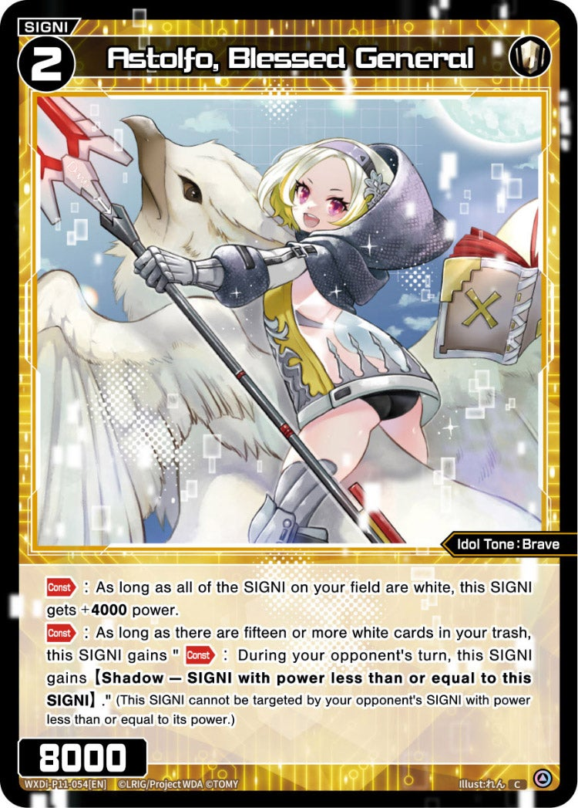

# Astolfo, Blessed General

## Thông tin lá

| Trường | Giá trị |
| --- | --- |
| Mã in | WXDi-P11-054[EN] |
| Set | WXDi-P11[EN] |
| Số thứ tự | 054 |
| Loại thẻ | SIGNI |
| Vị trí | Main Deck |
| Số bản | — (set booster, không áp dụng) |
| Màu | Trắng |
| Độ hiếm | C,C(P) |
| Minh họa | れん |
| Level | 2 |
| Limit | — |
| Power | 8000 |
| LRIG type / Class | Idol Tone：Brave |
| Team / Master | — |
| Cost | — |
| Grow cost | — |
| Use timing | — |
| Life Burst | Không |

## Card text chính thức

[Constant]: As long as all of the SIGNI on your field are white, this SIGNI gets +4000 power.
[Constant]: As long as there are fifteen or more white cards in your trash, this SIGNI gains "[Constant]: During your opponent's turn, this SIGNI gains 【Shadow — SIGNI with power less than or equal to this SIGNI】." (This SIGNI cannot be targeted by your opponent's SIGNI with power less than or equal to its power.)

## Power text / Life Burst

—

## Ghi chú minh họa
Artist: れん. Ảnh C được tải từ Card List tiếng Anh.

## FAQ chính thức

**Q. Is 【Shadow - SIGNI with power less than or equal to this SIGNI】 effective against the Life Burst of my opponent's SIGNI?**
A. Yes, for example, if this SIGNI has power 8000, it will not be targeted by Life Burst of SIGNI with power 8000.

## Ảnh biến thể

- [C(P)](../images/WXDi-P11-054P-EN.jpg)

## Nguồn
[Card List/FAQ chính thức](https://www.takaratomy.co.jp/products/en.wixoss/card/card.html?card_no=WXDi-P11-054%5BEN%5D ) · [Ảnh thẻ](https://www.takaratomy.co.jp/products/en.wixoss/card/thumb/WXDi-P11-054%5BEN%5D.jpg)
