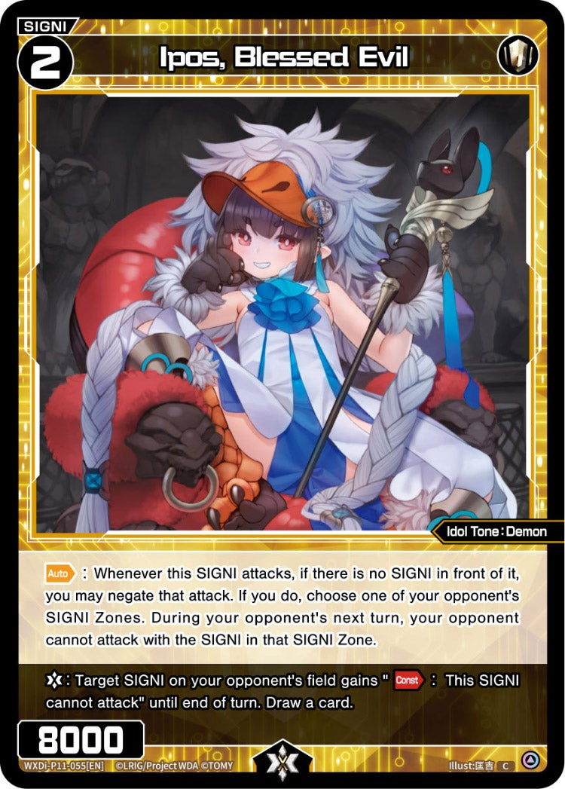

# Ipos, Blessed Evil

## Thông tin lá

| Trường | Giá trị |
| --- | --- |
| Mã in | WXDi-P11-055[EN] |
| Set | WXDi-P11[EN] |
| Số thứ tự | 055 |
| Loại thẻ | SIGNI |
| Vị trí | Main Deck |
| Số bản | — (set booster, không áp dụng) |
| Màu | Trắng |
| Độ hiếm | C,C(P) |
| Minh họa | 匡吉 |
| Level | 2 |
| Limit | — |
| Power | 8000 |
| LRIG type / Class | Idol Tone：Demon |
| Team / Master | — |
| Cost | — |
| Grow cost | — |
| Use timing | — |
| Life Burst | Có |

## Card text chính thức

[Auto]: Whenever this SIGNI attacks, if there is no SIGNI in front of it, you may negate that attack. If you do, choose one of your opponent's SIGNI Zones. During your opponent's next turn, your opponent cannot attack with the SIGNI in that SIGNI Zone.

## Power text / Life Burst

Target SIGNI on your opponent's field gains "[Constant]: This SIGNI cannot attack" until end of turn. Draw a card.

## Ghi chú minh họa
Artist: 匡吉. Ảnh C được tải từ Card List tiếng Anh.

## FAQ chính thức

**Q. If I choose one of SIGNI zone by this [Auto] ability, can SIGNI that subsequently put on that SIGNI zone attack?**
A. No. SIGNI cannot attack in the chosen SIGNI zone during next your opponent's turn, regardless of when it is put on the field.

## Ảnh biến thể

- [C(P)](../images/WXDi-P11-055P-EN.jpg)

## Nguồn
[Card List/FAQ chính thức](https://www.takaratomy.co.jp/products/en.wixoss/card/card.html?card_no=WXDi-P11-055%5BEN%5D ) · [Ảnh thẻ](https://www.takaratomy.co.jp/products/en.wixoss/card/thumb/WXDi-P11-055%5BEN%5D.jpg)
