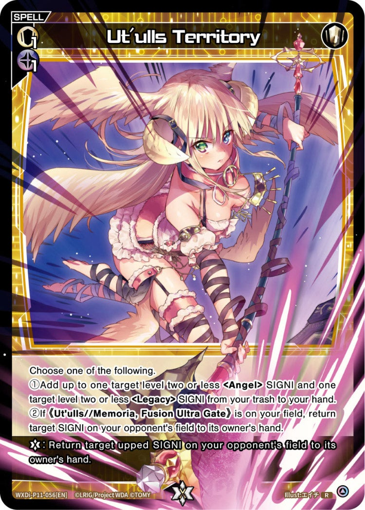

# Ut'ulls Territory

## Thông tin lá

| Trường | Giá trị |
| --- | --- |
| Mã in | WXDi-P11-056[EN] |
| Set | WXDi-P11[EN] |
| Số thứ tự | 056 |
| Loại thẻ | SPELL |
| Vị trí | Main Deck |
| Số bản | — (set booster, không áp dụng) |
| Màu | Trắng |
| Độ hiếm | R,R(P) |
| Minh họa | エイチ |
| Level | — |
| Limit | — |
| Power | 0 |
| LRIG type / Class | — |
| Team / Master | — |
| Cost | 《W》×１
《B》×１ |
| Grow cost | — |
| Use timing | — |
| Life Burst | Có |

## Card text chính thức

Choose one of the following.
①Add up to one target level two or less <Angel> SIGNI and one target level two or less <Legacy> SIGNI from your trash to your hand.
②If 《Ut'ulls//Memoria, Fusion Ultra Gate》 is on your field, return target SIGNI on your opponent's field to its owner's hand.

## Power text / Life Burst

Return target upped SIGNI on your opponent's field to its owner's hand.

## Ghi chú minh họa
Artist: エイチ. Ảnh R được tải từ Card List tiếng Anh.

## FAQ chính thức

**Q. If 《Ut'ulls//Memoria, Fusion Gate》 is placed undernearth SIGNI on my field,can I return my opponent's SIGNI to its owner's hand with the effect of this Spell (2)?**
A. No, you cannot. You can only refer to the 《Ut'ulls//Memoria, Fusion Gate》 when it is on your field as SIGNI, and the 《Ut'ulls//Memoria, Fusion Gate》 placed underneath SIGNI or attached to SIGNI by [Charm] is not considered to be on the field.

## Ảnh biến thể

- [R(P)](../images/WXDi-P11-056P-EN.jpg)

## Nguồn
[Card List/FAQ chính thức](https://www.takaratomy.co.jp/products/en.wixoss/card/card.html?card_no=WXDi-P11-056%5BEN%5D ) · [Ảnh thẻ](https://www.takaratomy.co.jp/products/en.wixoss/card/thumb/WXDi-P11-056%5BEN%5D.jpg)
