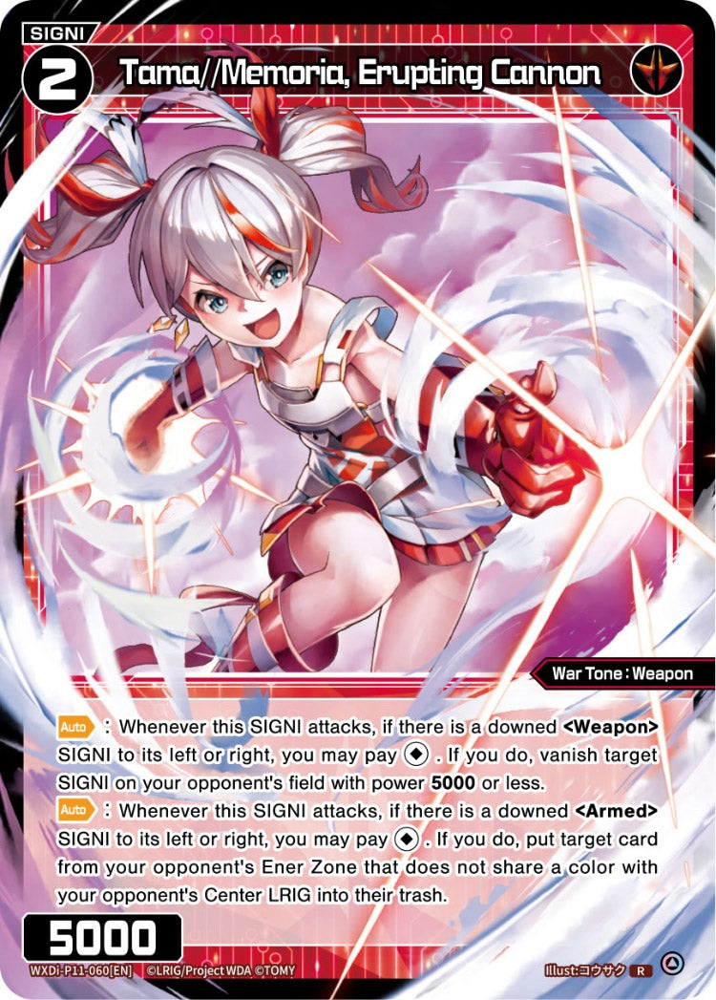

# Tama//Memoria, Erupting Cannon

## Thông tin lá

| Trường | Giá trị |
| --- | --- |
| Mã in | WXDi-P11-060[EN] |
| Set | WXDi-P11[EN] |
| Số thứ tự | 060 |
| Loại thẻ | SIGNI |
| Vị trí | Main Deck |
| Số bản | — (set booster, không áp dụng) |
| Màu | Đỏ |
| Độ hiếm | R,R(P) |
| Minh họa | コウサク |
| Level | 2 |
| Limit | — |
| Power | 5000 |
| LRIG type / Class | War Tone：Weapon |
| Team / Master | — |
| Cost | — |
| Grow cost | — |
| Use timing | — |
| Life Burst | Không |

## Card text chính thức

[Auto]: Whenever this SIGNI attacks, if there is a downed <Weapon> SIGNI to its left or right, you may pay {Colorless}. If you do, vanish target SIGNI on your opponent's field with power 5000 or less.
[Auto]: Whenever this SIGNI attacks, if there is a downed <Armed> SIGNI to its left or right, you may pay {Colorless}. If you do, put target card from your opponent's Ener Zone that does not share a color with your opponent's Center LRIG into their trash.

## Power text / Life Burst

—

## Ghi chú minh họa
Artist: コウサク. Ảnh R được tải từ Card List tiếng Anh.

## FAQ chính thức

**Q. If there is <Armed/Weapon> 《小剣　ミカムネ》 to the left or right of this SIGNI, is the [Auto] abilities triggered both?**
A. Yes, it is triggered.

## Ảnh biến thể

- [R(P)](../images/WXDi-P11-060P-EN.jpg)

## Nguồn
[Card List/FAQ chính thức](https://www.takaratomy.co.jp/products/en.wixoss/card/card.html?card_no=WXDi-P11-060%5BEN%5D ) · [Ảnh thẻ](https://www.takaratomy.co.jp/products/en.wixoss/card/thumb/WXDi-P11-060%5BEN%5D.jpg)
