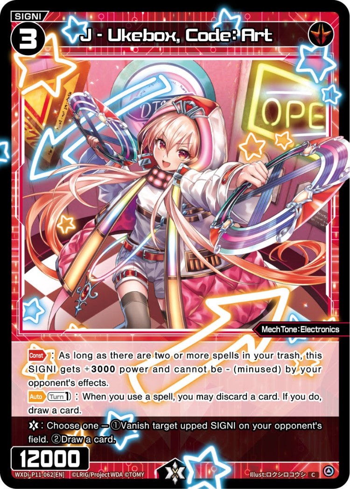

# J - Ukebox, Code: Art

## Thông tin lá

| Trường | Giá trị |
| --- | --- |
| Mã in | WXDi-P11-062[EN] |
| Set | WXDi-P11[EN] |
| Số thứ tự | 062 |
| Loại thẻ | SIGNI |
| Vị trí | Main Deck |
| Số bản | — (set booster, không áp dụng) |
| Màu | Đỏ |
| Độ hiếm | C,C(P) |
| Minh họa | ロクシロコウシ |
| Level | 3 |
| Limit | — |
| Power | 12000 |
| LRIG type / Class | Mech Tone：Electronics |
| Team / Master | — |
| Cost | — |
| Grow cost | — |
| Use timing | — |
| Life Burst | Có |

## Card text chính thức

[Constant]: As long as there are two or more spells in your trash, this SIGNI gets +3000 power and cannot be - (minused) by your opponent's effects.
[Auto] {1/Turn}: When you use a spell, you may discard a card. If you do, draw a card.

## Power text / Life Burst

Choose one — ①Vanish target upped SIGNI on your opponent's field. ②Draw a card.

## Ghi chú minh họa
Artist: ロクシロコウシ. Ảnh C được tải từ Card List tiếng Anh.

## FAQ chính thức

**Q. I used another spell when I had one spell in my trash. Against that spell, my opponent used [Spell Cut-in], and this SIGNI got -12000 power by the effect of [Spell Cut-in]. What happens to this SIGNI?**
A. Since your spell in use is still in the Check zone, the condition for the [Const] ability is not yet fulfilled and that SIGNI's power is reduced to 0 or less and it is vanished. The effect of your spell that was declared in use is then resolved.

## Ảnh biến thể

- [C(P)](../images/WXDi-P11-062P-EN.jpg)

## Nguồn
[Card List/FAQ chính thức](https://www.takaratomy.co.jp/products/en.wixoss/card/card.html?card_no=WXDi-P11-062%5BEN%5D ) · [Ảnh thẻ](https://www.takaratomy.co.jp/products/en.wixoss/card/thumb/WXDi-P11-062%5BEN%5D.jpg)
