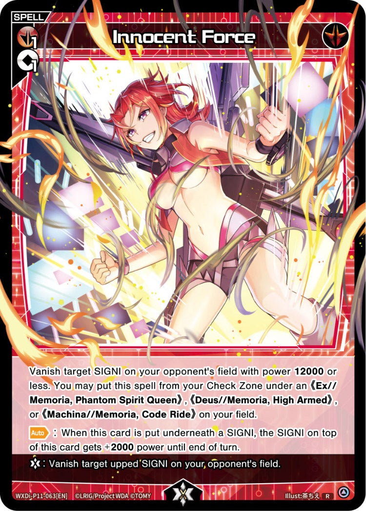

# Innocent Force

## Thông tin lá

| Trường | Giá trị |
| --- | --- |
| Mã in | WXDi-P11-063[EN] |
| Set | WXDi-P11[EN] |
| Số thứ tự | 063 |
| Loại thẻ | SPELL |
| Vị trí | Main Deck |
| Số bản | — (set booster, không áp dụng) |
| Màu | Đỏ |
| Độ hiếm | R,R(P) |
| Minh họa | 茶ちえ |
| Level | — |
| Limit | — |
| Power | 0 |
| LRIG type / Class | — |
| Team / Master | — |
| Cost | 《R》×１
《C》×１ |
| Grow cost | — |
| Use timing | — |
| Life Burst | Có |

## Card text chính thức

Vanish target SIGNI on your opponent's field with power 12000 or less. You may put this spell from your Check Zone under an 《Ex//Memoria, Phantom Spirit Queen》, 《Deus//Memoria, High Armed》, or 《Machina//Memoria, Code Ride》 on your field.

[Auto]: When this card is put underneath a SIGNI, the SIGNI on top of this card gets +2000 power until end of turn.

## Power text / Life Burst

Vanish target upped SIGNI on your opponent's field.

## Ghi chú minh họa
Artist: 茶ちえ. Ảnh R được tải từ Card List tiếng Anh.

## FAQ chính thức

— (không có FAQ riêng cho mã này trên trang FAQ tiếng Anh.)

## Ảnh biến thể

- [R(P)](../images/WXDi-P11-063P-EN.jpg)

## Nguồn
[Card List/FAQ chính thức](https://www.takaratomy.co.jp/products/en.wixoss/card/card.html?card_no=WXDi-P11-063%5BEN%5D ) · [Ảnh thẻ](https://www.takaratomy.co.jp/products/en.wixoss/card/thumb/WXDi-P11-063%5BEN%5D.jpg)
