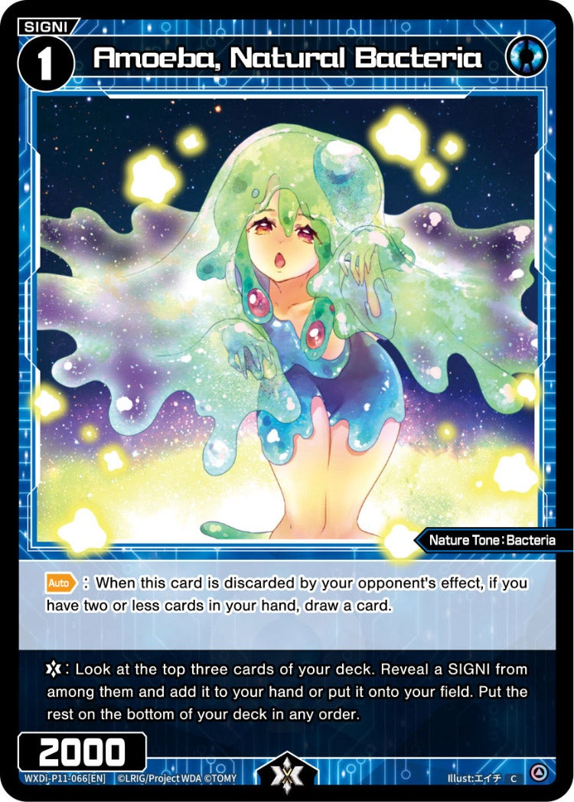

# Amoeba, Natural Bacteria

## Thông tin lá

| Trường | Giá trị |
| --- | --- |
| Mã in | WXDi-P11-066[EN] |
| Set | WXDi-P11[EN] |
| Số thứ tự | 066 |
| Loại thẻ | SIGNI |
| Vị trí | Main Deck |
| Số bản | — (set booster, không áp dụng) |
| Màu | Xanh dương |
| Độ hiếm | C,C(P) |
| Minh họa | エイチ |
| Level | 1 |
| Limit | — |
| Power | 2000 |
| LRIG type / Class | Nature Tone：Bacteria |
| Team / Master | — |
| Cost | — |
| Grow cost | — |
| Use timing | — |
| Life Burst | Có |

## Card text chính thức

[Auto]: When this card is discarded by your opponent's effect, if you have two or less cards in your hand, draw a card.

## Power text / Life Burst

Look at the top three cards of your deck. Reveal a SIGNI from among them and add it to your hand or put it onto your field. Put the rest on the bottom of your deck in any order.

## Ghi chú minh họa
Artist: エイチ. Ảnh C được tải từ Card List tiếng Anh.

## FAQ chính thức

**Q. I have five cards in my hand, one of which is 《Amoeba, Natural Bacteria》. If my cards are discarded from my hand by my opponent's effect, is the [Auto] ability of 《Amoeba, Natural Bacteria》 triggered?**
A. Yes, it triggers. The ability triggers when this card is discarded and checks at the number of cards in your hand when it triggers, so you can draw a card if you have zero cards in your hand.

**Q. I have four cards in my hand, two of which are 《Amoeba, Natural Bacteria》. If my opponent discards two 《Amoeba, Natural Bacteria》 cards from my hand by my opponent's effect, do both [Auto] abilities of 《Amoeba, Natural Bacteria》 activate?**
A. Both trigger, but you can only draw a card as a result. After the two 《Amoeba, Natural Bacteria》 cards are discarded, their abilities trigger in turn: when the first one triggers, you have two cards in your hand, so you draw a card; when the second one triggers, you have three cards in your hand, so nothing happens and the effect ends.

## Ảnh biến thể

- [C(P)](../images/WXDi-P11-066P-EN.jpg)

## Nguồn
[Card List/FAQ chính thức](https://www.takaratomy.co.jp/products/en.wixoss/card/card.html?card_no=WXDi-P11-066%5BEN%5D ) · [Ảnh thẻ](https://www.takaratomy.co.jp/products/en.wixoss/card/thumb/WXDi-P11-066%5BEN%5D.jpg)
