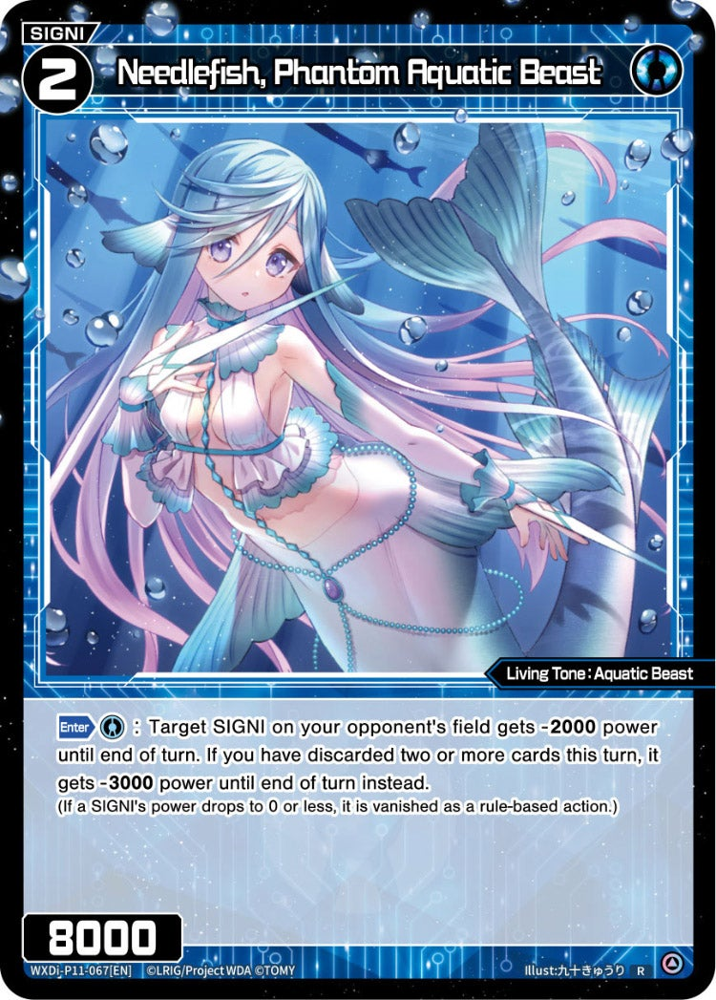

# Needlefish, Phantom Aquatic Beast

## Thông tin lá

| Trường | Giá trị |
| --- | --- |
| Mã in | WXDi-P11-067[EN] |
| Set | WXDi-P11[EN] |
| Số thứ tự | 067 |
| Loại thẻ | SIGNI |
| Vị trí | Main Deck |
| Số bản | — (set booster, không áp dụng) |
| Màu | Xanh dương |
| Độ hiếm | R,R(P) |
| Minh họa | 九十きゅうり |
| Level | 2 |
| Limit | — |
| Power | 8000 |
| LRIG type / Class | Living Tone：Aquatic Beast |
| Team / Master | — |
| Cost | — |
| Grow cost | — |
| Use timing | — |
| Life Burst | Không |

## Card text chính thức

[Enter] {Blue}: Target SIGNI on your opponent's field gets -2000 power until end of turn. If you have discarded two or more cards this turn, it gets -3000 power until end of turn instead.
(If a SIGNI's power drops to 0 or less, it is vanished as a rule-based action.)

## Power text / Life Burst

—

## Ghi chú minh họa
Artist: 九十きゅうり. Ảnh R được tải từ Card List tiếng Anh.

## FAQ chính thức

**Q. Does the [Enter] ability count the cards that were discarded before this SIGNI is put on the field?**
A. Yes, count whether you have discarded two cards this turn, regardless of whether you did so before or after this SIGNI was put on the field.

## Ảnh biến thể

- [R(P)](../images/WXDi-P11-067P-EN.jpg)

## Nguồn
[Card List/FAQ chính thức](https://www.takaratomy.co.jp/products/en.wixoss/card/card.html?card_no=WXDi-P11-067%5BEN%5D ) · [Ảnh thẻ](https://www.takaratomy.co.jp/products/en.wixoss/card/thumb/WXDi-P11-067%5BEN%5D.jpg)
