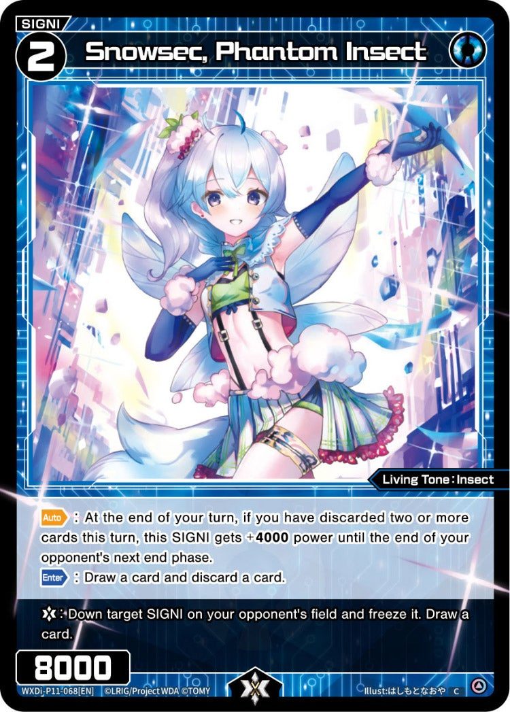

# Snowsec, Phantom Insect

## Thông tin lá

| Trường | Giá trị |
| --- | --- |
| Mã in | WXDi-P11-068[EN] |
| Set | WXDi-P11[EN] |
| Số thứ tự | 068 |
| Loại thẻ | SIGNI |
| Vị trí | Main Deck |
| Số bản | — (set booster, không áp dụng) |
| Màu | Xanh dương |
| Độ hiếm | C,C(P) |
| Minh họa | はしもとなおや |
| Level | 2 |
| Limit | — |
| Power | 8000 |
| LRIG type / Class | Living Tone：Insect |
| Team / Master | — |
| Cost | — |
| Grow cost | — |
| Use timing | — |
| Life Burst | Có |

## Card text chính thức

[Auto]: At the end of your turn, if you have discarded two or more cards this turn, this SIGNI gets +4000 power until the end of your opponent's next end phase.
[Enter]: Draw a card and discard a card.

## Power text / Life Burst

Down target SIGNI on your opponent's field and freeze it. Draw a card.

## Ghi chú minh họa
Artist: はしもとなおや. Ảnh C được tải từ Card List tiếng Anh.

## FAQ chính thức

**Q. Does the [Auto] ability count the cards that were discarded before this SIGNI is put on the field?**
A. Yes, count whether you have discarded two cards this turn, regardless of whether you did so before or after this SIGNI was put on the field.

## Ảnh biến thể

- [C(P)](../images/WXDi-P11-068P-EN.jpg)

## Nguồn
[Card List/FAQ chính thức](https://www.takaratomy.co.jp/products/en.wixoss/card/card.html?card_no=WXDi-P11-068%5BEN%5D ) · [Ảnh thẻ](https://www.takaratomy.co.jp/products/en.wixoss/card/thumb/WXDi-P11-068%5BEN%5D.jpg)
