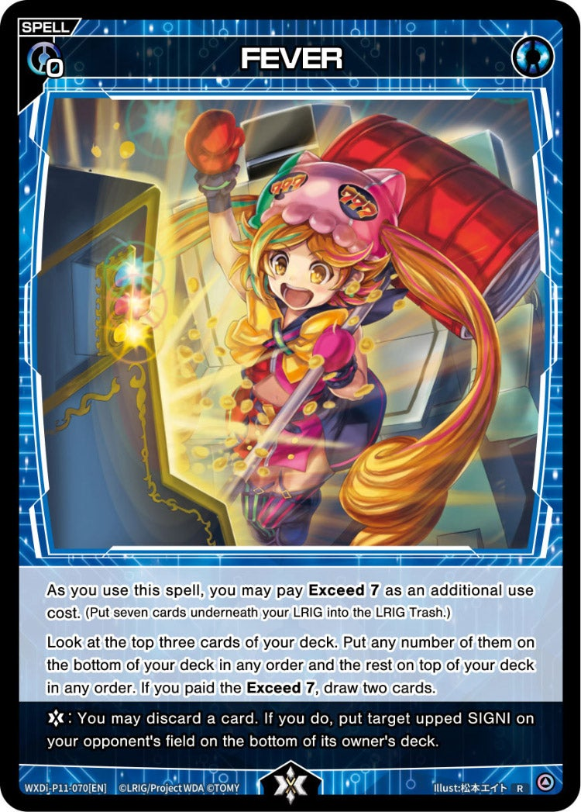

# Fever

## Thông tin lá

| Trường | Giá trị |
| --- | --- |
| Mã in | WXDi-P11-070[EN] |
| Set | WXDi-P11[EN] |
| Số thứ tự | 070 |
| Loại thẻ | SPELL |
| Vị trí | Main Deck |
| Số bản | — (set booster, không áp dụng) |
| Màu | Xanh dương |
| Độ hiếm | R,R(P) |
| Minh họa | 松本エイト |
| Level | — |
| Limit | — |
| Power | 0 |
| LRIG type / Class | — |
| Team / Master | — |
| Cost | 《U》×０ |
| Grow cost | — |
| Use timing | — |
| Life Burst | Có |

## Card text chính thức

As you use this spell, you may pay Exceed 7 as an additional use cost. (Put seven cards underneath your LRIG into the LRIG Trash.)

Look at the top three cards of your deck. Put any number of them on the bottom of your deck in any order and the rest on top of your deck in any order. If you paid the Exceed 7, draw two cards.

## Power text / Life Burst

You may discard a card. If you do, put target upped SIGNI on your opponent's field on the bottom of its owner's deck.

## Ghi chú minh họa
Artist: 松本エイト. Ảnh R được tải từ Card List tiếng Anh.

## FAQ chính thức

**Q. If I have paid Exceed 7, do I process with the effect of only drawing two cards?**
A. No. After processing with the effect of looking at the top three cards of your deck in the first half, draw two cards as an additional effect.

## Ảnh biến thể

- [R(P)](../images/WXDi-P11-070P-EN.jpg)

## Nguồn
[Card List/FAQ chính thức](https://www.takaratomy.co.jp/products/en.wixoss/card/card.html?card_no=WXDi-P11-070%5BEN%5D ) · [Ảnh thẻ](https://www.takaratomy.co.jp/products/en.wixoss/card/thumb/WXDi-P11-070%5BEN%5D.jpg)
