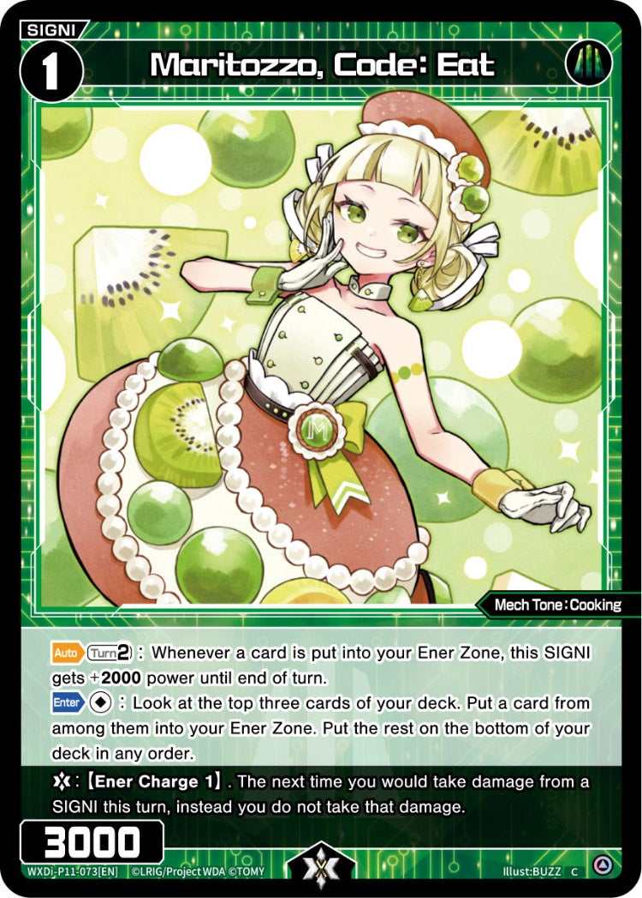

# Maritozzo, Code: Eat

## Thông tin lá

| Trường | Giá trị |
| --- | --- |
| Mã in | WXDi-P11-073[EN] |
| Set | WXDi-P11[EN] |
| Số thứ tự | 073 |
| Loại thẻ | SIGNI |
| Vị trí | Main Deck |
| Số bản | — (set booster, không áp dụng) |
| Màu | Xanh lá |
| Độ hiếm | C,C(P) |
| Minh họa | BUZZ |
| Level | 1 |
| Limit | — |
| Power | 3000 |
| LRIG type / Class | Mech Tone：Cooking |
| Team / Master | — |
| Cost | — |
| Grow cost | — |
| Use timing | — |
| Life Burst | Có |

## Card text chính thức

[Auto] {2/Turn}: Whenever a card is put into your Ener Zone, this SIGNI gets +2000 power until end of turn.
[Enter] {Colorless}: Look at the top three cards of your deck. Put a card from among them into your Ener Zone. Put the rest on the bottom of your deck in any order.

## Power text / Life Burst

【Ener Charge 1】. The next time you would take damage from a SIGNI this turn, instead you do not take that damage.

## Ghi chú minh họa
Artist: BUZZ. Ảnh C được tải từ Card List tiếng Anh.

## FAQ chính thức

**Q. If I performed [Ener Charge 2], is the [Auto] ability triggered?**
A. Yes, it is triggered. Two cards have been put into your Ener zone, so it is triggered twice.

## Ảnh biến thể

- [C(P)](../images/WXDi-P11-073P-EN.jpg)

## Nguồn
[Card List/FAQ chính thức](https://www.takaratomy.co.jp/products/en.wixoss/card/card.html?card_no=WXDi-P11-073%5BEN%5D ) · [Ảnh thẻ](https://www.takaratomy.co.jp/products/en.wixoss/card/thumb/WXDi-P11-073%5BEN%5D.jpg)
