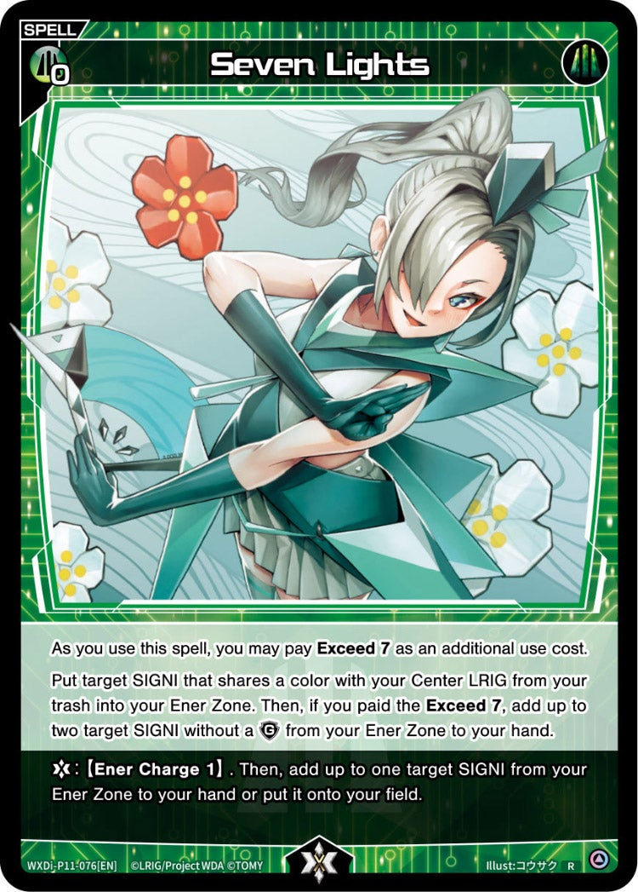

# Seven Lights

## Thông tin lá

| Trường | Giá trị |
| --- | --- |
| Mã in | WXDi-P11-076[EN] |
| Set | WXDi-P11[EN] |
| Số thứ tự | 076 |
| Loại thẻ | SPELL |
| Vị trí | Main Deck |
| Số bản | — (set booster, không áp dụng) |
| Màu | Xanh lá |
| Độ hiếm | R,R(P) |
| Minh họa | コウサク |
| Level | — |
| Limit | — |
| Power | 0 |
| LRIG type / Class | — |
| Team / Master | — |
| Cost | 《G》×０ |
| Grow cost | — |
| Use timing | — |
| Life Burst | Có |

## Card text chính thức

As you use this spell, you may pay Exceed 7 as an additional use cost.

Put target SIGNI that shares a color with your Center LRIG from your trash into your Ener Zone. Then, if you paid the Exceed 7, add up to two target SIGNI without a {Guard Icon} from your Ener Zone to your hand.

## Power text / Life Burst

【Ener Charge 1】. Then, add up to one target SIGNI from your Ener Zone to your hand or put it onto your field.

## Ghi chú minh họa
Artist: コウサク. Ảnh R được tải từ Card List tiếng Anh.

## FAQ chính thức

**Q. Can I put the spell itself that is being used into the Ener zone with the effect of this spell?**
A. No you cannot. This spell in use is in the Check zone, not in the trash.

## Ảnh biến thể

- [R(P)](../images/WXDi-P11-076P-EN.jpg)

## Nguồn
[Card List/FAQ chính thức](https://www.takaratomy.co.jp/products/en.wixoss/card/card.html?card_no=WXDi-P11-076%5BEN%5D ) · [Ảnh thẻ](https://www.takaratomy.co.jp/products/en.wixoss/card/thumb/WXDi-P11-076%5BEN%5D.jpg)
