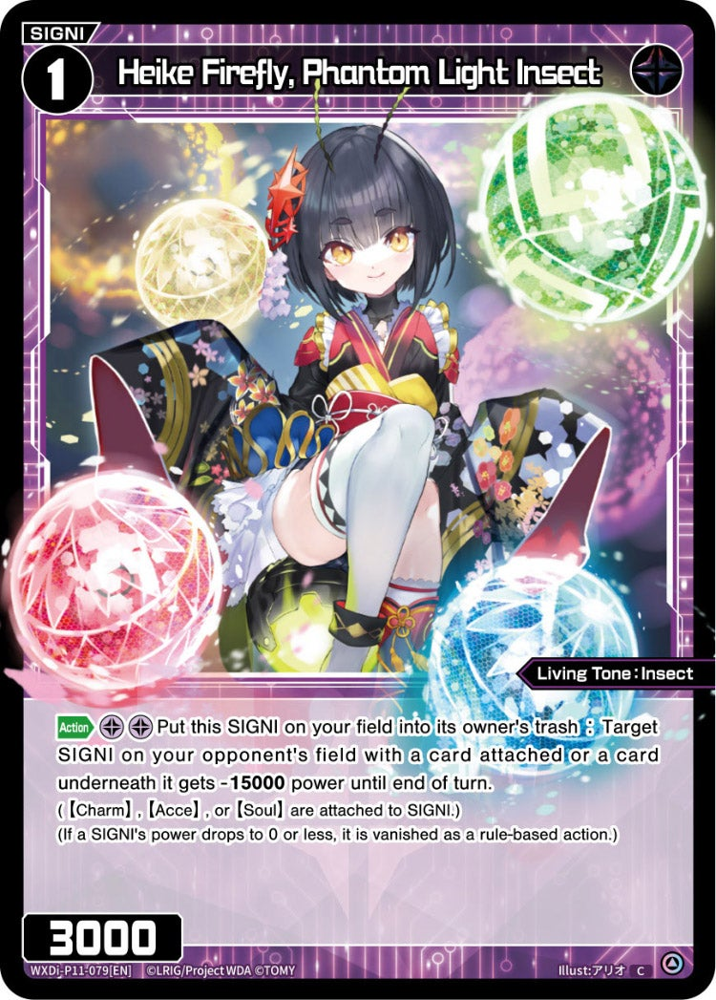

# Heike Firefly, Phantom Light Insect

## Thông tin lá

| Trường | Giá trị |
| --- | --- |
| Mã in | WXDi-P11-079[EN] |
| Set | WXDi-P11[EN] |
| Số thứ tự | 079 |
| Loại thẻ | SIGNI |
| Vị trí | Main Deck |
| Số bản | — (set booster, không áp dụng) |
| Màu | Đen |
| Độ hiếm | C,C(P) |
| Minh họa | アリオ |
| Level | 1 |
| Limit | — |
| Power | 3000 |
| LRIG type / Class | Living Tone：Insect |
| Team / Master | — |
| Cost | — |
| Grow cost | — |
| Use timing | — |
| Life Burst | Không |

## Card text chính thức

[Action] {Black} {Black} Put this SIGNI on your field into its owner's trash: Target SIGNI on your opponent's field with a card attached or a card underneath it gets -15000 power until end of turn.
(【Charm】, 【Acce】, or 【Soul】 are attached to SIGNI.)
(If a SIGNI's power drops to 0 or less, it is vanished as a rule-based action.)

## Power text / Life Burst

—

## Ghi chú minh họa
Artist: アリオ. Ảnh C được tải từ Card List tiếng Anh.

## FAQ chính thức

**Q. By 《Digital Aya! III》, etc.,  SIGNI is turned face down and I place SIGNI on the top of it. Is that turned face down SIGNI treated as a SIGNI with a card underneath?**
A. No. Cards placed face down on the SIGNI zone are not treated as cards placed undernearth a SIGNI, even if they are physically placed undernearth a SIGNI. A card that is placed undernearth a SIGNI is a card that is placed by an effect that places it under a SIGNI or by [Rise], etc.

## Ảnh biến thể

- [C(P)](../images/WXDi-P11-079P-EN.jpg)

## Nguồn
[Card List/FAQ chính thức](https://www.takaratomy.co.jp/products/en.wixoss/card/card.html?card_no=WXDi-P11-079%5BEN%5D ) · [Ảnh thẻ](https://www.takaratomy.co.jp/products/en.wixoss/card/thumb/WXDi-P11-079%5BEN%5D.jpg)
