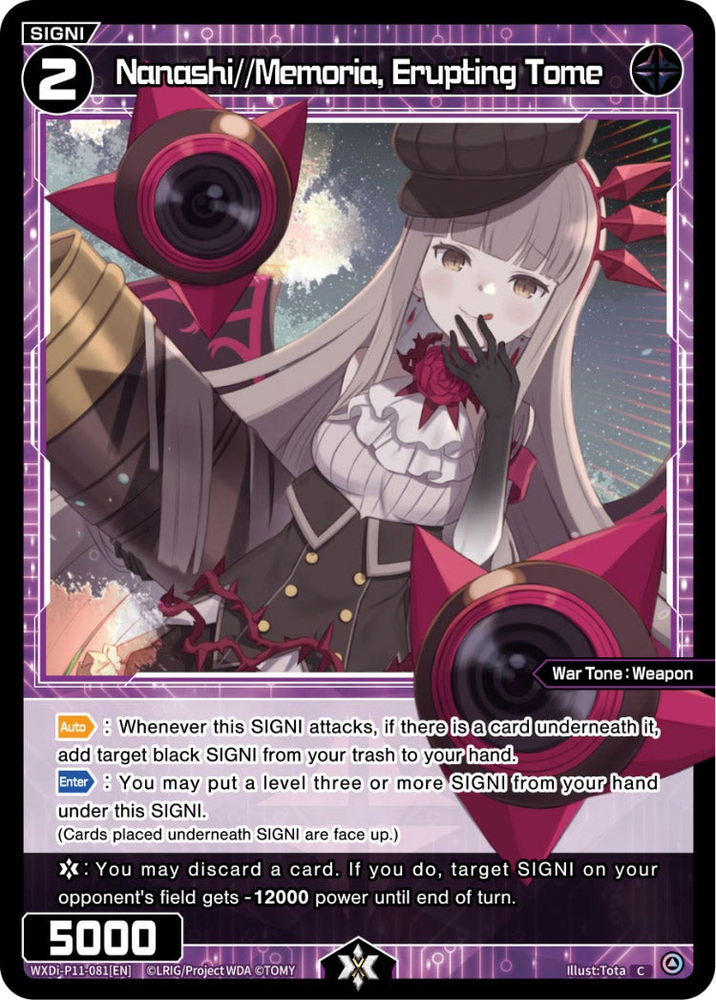

# Nanashi//Memoria, Erupting Tome

## Thông tin lá

| Trường | Giá trị |
| --- | --- |
| Mã in | WXDi-P11-081[EN] |
| Set | WXDi-P11[EN] |
| Số thứ tự | 081 |
| Loại thẻ | SIGNI |
| Vị trí | Main Deck |
| Số bản | — (set booster, không áp dụng) |
| Màu | Đen |
| Độ hiếm | C,C(P) |
| Minh họa | Tota |
| Level | 2 |
| Limit | — |
| Power | 5000 |
| LRIG type / Class | War Tone：Weapon |
| Team / Master | — |
| Cost | — |
| Grow cost | — |
| Use timing | — |
| Life Burst | Có |

## Card text chính thức

[Auto]: Whenever this SIGNI attacks, if there is a card underneath it, add target black SIGNI from your trash to your hand.
[Enter]: You may put a level three or more SIGNI from your hand under this SIGNI.
(Cards placed underneath SIGNI are face up.)

## Power text / Life Burst

You may discard a card. If you do, target SIGNI on your opponent's field gets -12000 power until end of turn.

## Ghi chú minh họa
Artist: Tota. Ảnh C được tải từ Card List tiếng Anh.

## FAQ chính thức

**Q. My opponent's 《Digital Aya! III》 or other effects, my SIGNI is turned face down and I put 《Nanashi//Memoria, Erupting Tome》 on top of it. Is it treated as if there is a card underneath this SIGNI by the [Auto] ability?**
A. No. Cards placed face down on the SIGNI zone are not treated as cards placed undernearth a SIGNI, even if they are physically placed undernearth a SIGNI. A card that is placed undernearth a SIGNI is a card that is placed by an effect that places it under a SIGNI or by [Rise], etc.

## Ảnh biến thể

- [C(P)](../images/WXDi-P11-081P-EN.jpg)

## Nguồn
[Card List/FAQ chính thức](https://www.takaratomy.co.jp/products/en.wixoss/card/card.html?card_no=WXDi-P11-081%5BEN%5D ) · [Ảnh thẻ](https://www.takaratomy.co.jp/products/en.wixoss/card/thumb/WXDi-P11-081%5BEN%5D.jpg)
