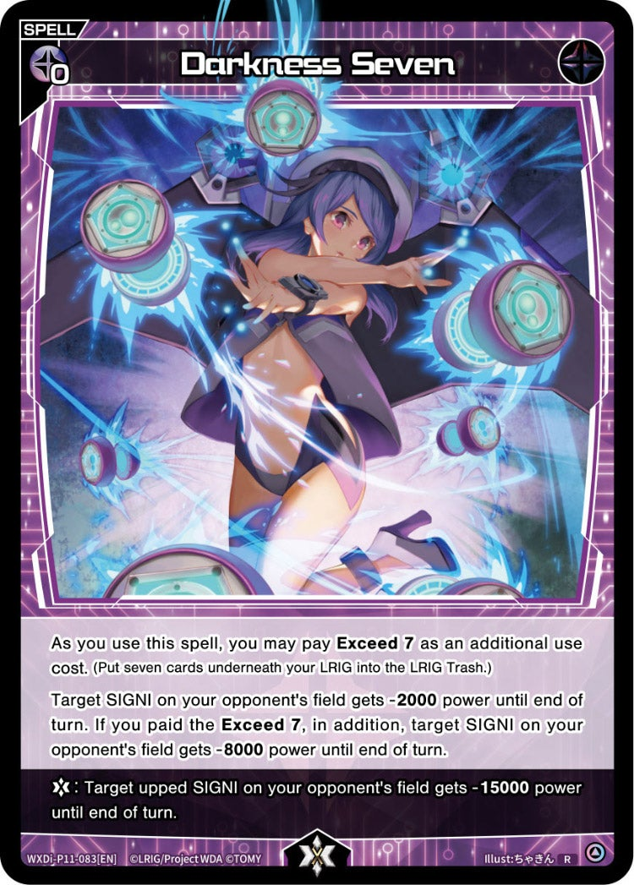

# Darkness Seven

## Thông tin lá

| Trường | Giá trị |
| --- | --- |
| Mã in | WXDi-P11-083[EN] |
| Set | WXDi-P11[EN] |
| Số thứ tự | 083 |
| Loại thẻ | SPELL |
| Vị trí | Main Deck |
| Số bản | — (set booster, không áp dụng) |
| Màu | Đen |
| Độ hiếm | R,R(P) |
| Minh họa | ちゃきん |
| Level | — |
| Limit | — |
| Power | 0 |
| LRIG type / Class | — |
| Team / Master | — |
| Cost | 《B》×０ |
| Grow cost | — |
| Use timing | — |
| Life Burst | Có |

## Card text chính thức

As you use this spell, you may pay Exceed 7 as an additional use cost. (Put seven cards underneath your LRIG into the LRIG Trash.)

Target SIGNI on your opponent's field gets -2000 power until end of turn. If you paid the Exceed 7, in addition, target SIGNI on your opponent's field gets -8000 power until end of turn.

## Power text / Life Burst

Target upped SIGNI on your opponent's field gets -15000 power until end of turn.

## Ghi chú minh họa
Artist: ちゃきん. Ảnh R được tải từ Card List tiếng Anh.

## FAQ chính thức

**Q. May I choose separately which SIGNI that gets -2000 power and which that gets -8000 power by this effect?**
A. Yes, you can choose each one different SIGNI or the same SIGNI.

## Ảnh biến thể

- [R(P)](../images/WXDi-P11-083P-EN.jpg)

## Nguồn
[Card List/FAQ chính thức](https://www.takaratomy.co.jp/products/en.wixoss/card/card.html?card_no=WXDi-P11-083%5BEN%5D ) · [Ảnh thẻ](https://www.takaratomy.co.jp/products/en.wixoss/card/thumb/WXDi-P11-083%5BEN%5D.jpg)
