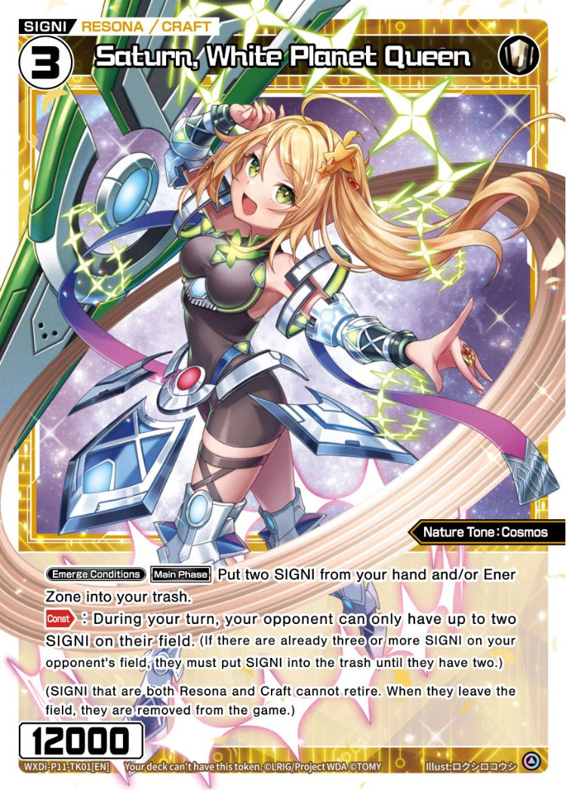

# Saturn, White Planet Queen

## Thông tin lá

| Trường | Giá trị |
| --- | --- |
| Mã in | WXDi-P11-TK01[EN] |
| Set | WXDi-P11[EN] |
| Số thứ tự | TK01 |
| Loại thẻ | RESONA |
| Vị trí | Ngoài deck (token/special) |
| Số bản | — (set booster, không áp dụng) |
| Màu | Trắng |
| Độ hiếm | TK,TK(P) |
| Minh họa | ロクシロコウシ |
| Level | 3 |
| Limit | — |
| Power | 12000 |
| LRIG type / Class | Nature Tone：Cosmos |
| Team / Master | — |
| Cost | — |
| Grow cost | — |
| Use timing | — |
| Life Burst | Không |

## Card text chính thức

[Emerge Conditions] {Main Phase Icon} Put two SIGNI from your hand and/or Ener Zone into your trash.
[Constant]: During your turn, your opponent can only have up to two SIGNI on their field. (If there are already three or more SIGNI on your opponent's field, they must put SIGNI into the trash until they have two.)

(SIGNI that are both Resona and Craft cannot retire. When they leave the field, they are removed from the game.)

## Power text / Life Burst

—

## Ghi chú minh họa
Artist: ロクシロコウシ. Ảnh TK được tải từ Card List tiếng Anh.

## FAQ chính thức

**Q. How is this SIGNI put on the field?**
A. This SIGNI in the LRIG Deck can be put on the field from the LRIG Deck by fulfilling the conditions in [Emerge Conditions], just as you would put a SIGNI from your hand in the main phase.

## Ảnh biến thể

- [TK](../images/WXDi-P11-TK01P-EN.jpg)

## Nguồn
[Card List/FAQ chính thức](https://www.takaratomy.co.jp/products/en.wixoss/card/card.html?card_no=WXDi-P11-TK01%5BEN%5D ) · [Ảnh thẻ](https://www.takaratomy.co.jp/products/en.wixoss/card/thumb/WXDi-P11-TK01%5BEN%5D.jpg)
