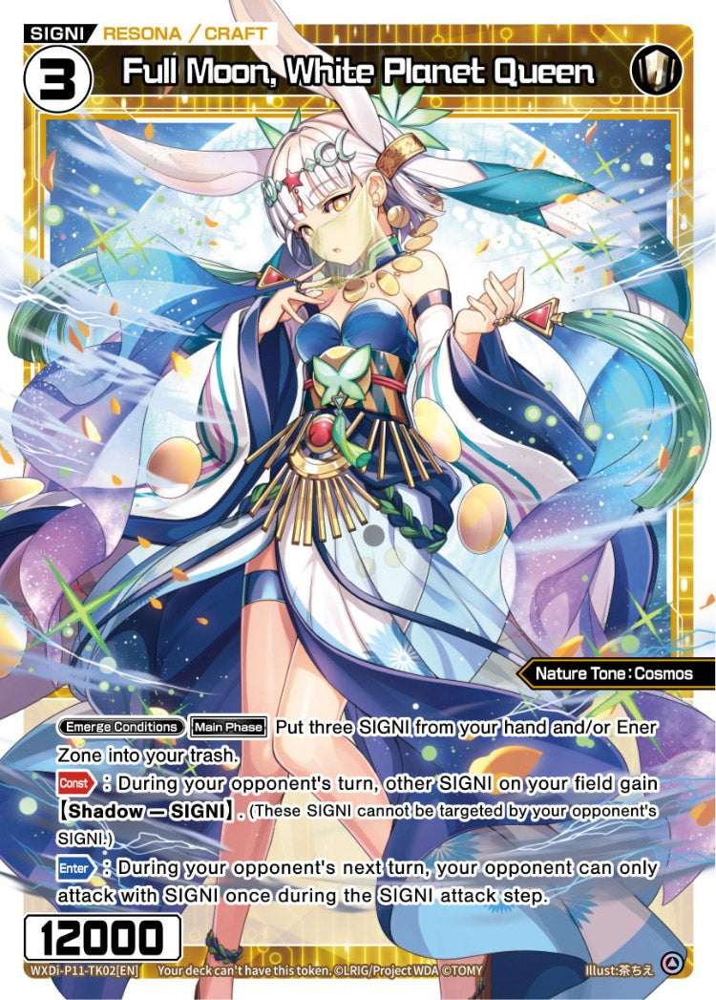

# Full Moon, White Planet Queen

## Thông tin lá

| Trường | Giá trị |
| --- | --- |
| Mã in | WXDi-P11-TK02[EN] |
| Set | WXDi-P11[EN] |
| Số thứ tự | TK02 |
| Loại thẻ | RESONA |
| Vị trí | Ngoài deck (token/special) |
| Số bản | — (set booster, không áp dụng) |
| Màu | Trắng |
| Độ hiếm | TK,TK(P) |
| Minh họa | 茶ちえ |
| Level | 3 |
| Limit | — |
| Power | 12000 |
| LRIG type / Class | Nature Tone：Cosmos |
| Team / Master | — |
| Cost | — |
| Grow cost | — |
| Use timing | — |
| Life Burst | Không |

## Card text chính thức

[Emerge Conditions] {Main Phase Icon} Put three SIGNI from your hand and/or Ener Zone into your trash.
[Constant]: During your opponent's turn, other SIGNI on your field gain 【Shadow — SIGNI】. (These SIGNI cannot be targeted by your opponent's SIGNI.)
[Enter]: During your opponent's next turn, your opponent can only attack with SIGNI once during the SIGNI attack step.

## Power text / Life Burst

—

## Ghi chú minh họa
Artist: 茶ちえ. Ảnh TK được tải từ Card List tiếng Anh.

## FAQ chính thức

**Q. How is this SIGNI put on the field?**
A. This SIGNI in the LRIG Deck can be put on the field from the LRIG Deck by fulfilling the conditions in [Emerge Conditions], just as you would put a SIGNI from your hand in the main phase.

**Q. On my opponent's turn following the use of this SIGNI's [Enter] ability, my opponent used 《ネクスト・フューチャー》. After attacking one in the first SIGNI Attack step, can my opponent attack in the additional SIGNI Attack step?**
A. No, your opponent cannot. Even if there are multiple SIGNI Attack Steps, your opponent can only attack once in SIGNI Attack Step throughout the turn.

## Ảnh biến thể

- [TK](../images/WXDi-P11-TK02P-EN.jpg)

## Nguồn
[Card List/FAQ chính thức](https://www.takaratomy.co.jp/products/en.wixoss/card/card.html?card_no=WXDi-P11-TK02%5BEN%5D ) · [Ảnh thẻ](https://www.takaratomy.co.jp/products/en.wixoss/card/thumb/WXDi-P11-TK02%5BEN%5D.jpg)
