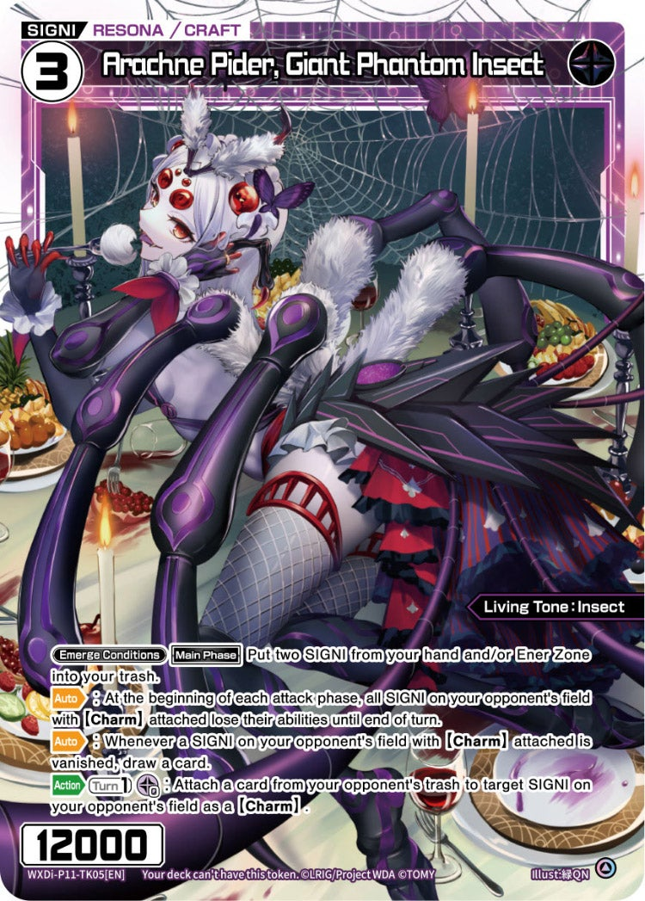

# Arachne Pider, Giant Phantom Insect

## Thông tin lá

| Trường | Giá trị |
| --- | --- |
| Mã in | WXDi-P11-TK05[EN] |
| Set | WXDi-P11[EN] |
| Số thứ tự | TK05 |
| Loại thẻ | RESONA |
| Vị trí | Ngoài deck (token/special) |
| Số bản | — (set booster, không áp dụng) |
| Màu | Đen |
| Độ hiếm | TK,TK(P) |
| Minh họa | 緑QN |
| Level | 3 |
| Limit | — |
| Power | 12000 |
| LRIG type / Class | Living Tone：Insect |
| Team / Master | — |
| Cost | — |
| Grow cost | — |
| Use timing | — |
| Life Burst | Không |

## Card text chính thức

[Emerge Conditions] {Main Phase Icon} Put two SIGNI from your hand and/or Ener Zone into your trash.
[Auto]: At the beginning of each attack phase, all SIGNI on your opponent's field with 【Charm】 attached lose their abilities until end of turn.
[Auto]: Whenever a SIGNI on your opponent's field with 【Charm】 attached is vanished, draw a card.
[Action] {1/Turn} {Blackx0}: Attach a card from your opponent's trash to target SIGNI on your opponent's field as a 【Charm】.

## Power text / Life Burst

—

## Ghi chú minh họa
Artist: 緑QN. Ảnh TK được tải từ Card List tiếng Anh.

## FAQ chính thức

**Q. How is this SIGNI put on the field?**
A. This SIGNI in the LRIG Deck can be put on the field from the LRIG Deck by fulfilling the conditions in [Emerge Conditions], just as you would put a SIGNI from your hand in the main phase.

**Q. After the first [Auto] ability is triggered, does SIGNI attached with new [Charm] lose its abilities during the same turn?**
A. No, it does not lose abilities. SIGNI with [Charm] at the time that [Auto] ability is triggered at the beginning of the Attack Phase loses the abilities. Thereafter, SIGNI are unaffected whether [Charm] is attached or not.

## Ảnh biến thể

- [TK](../images/WXDi-P11-TK05P-EN.jpg)

## Nguồn
[Card List/FAQ chính thức](https://www.takaratomy.co.jp/products/en.wixoss/card/card.html?card_no=WXDi-P11-TK05%5BEN%5D ) · [Ảnh thẻ](https://www.takaratomy.co.jp/products/en.wixoss/card/thumb/WXDi-P11-TK05%5BEN%5D.jpg)
