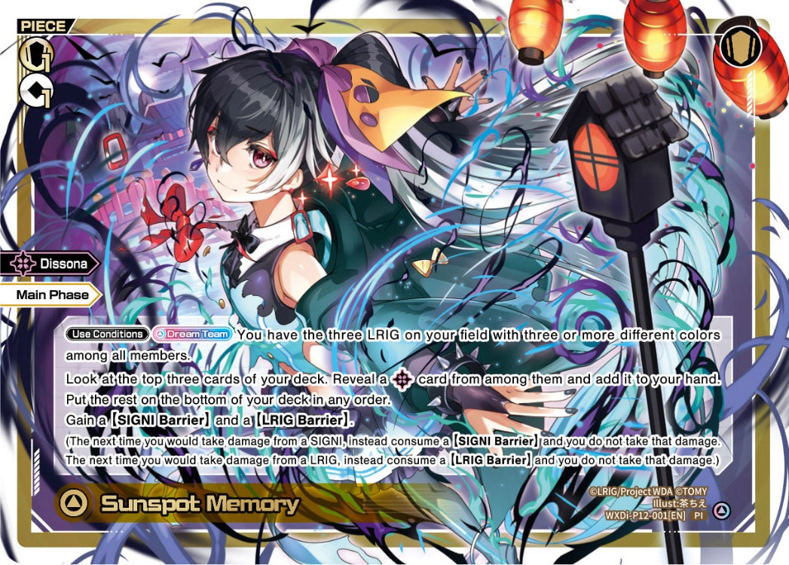

# Sunspot Memory

## Thông tin lá

| Trường | Giá trị |
| --- | --- |
| Mã in | WXDi-P12-001[EN] |
| Set | WXDi-P12[EN] |
| Số thứ tự | 001 |
| Loại thẻ | PIECE |
| Vị trí | LRIG Deck |
| Số bản | — (set booster, không áp dụng) |
| Màu | Trắng |
| Độ hiếm | PI,LRP |
| Minh họa | 茶ちえ |
| Level | — |
| Limit | — |
| Power | 0 |
| LRIG type / Class | — |
| Team / Master | — |
| Cost | 《W》×１ / 《C》×１ |
| Grow cost | — |
| Use timing | Main Phase |
| Life Burst | Không |

## Card text chính thức

[Use Conditions] [Dream Team] You have the three LRIG on your field with three or more different colors among all members.

Look at the top three cards of your deck. Reveal a {Dissona Icon} card from among them and add it to your hand. Put the rest on the bottom of your deck in any order.
Gain a 【SIGNI Barrier】 and a 【LRIG Barrier】.
(The next time you would take damage from a SIGNI, instead consume a 【SIGNI Barrier】and you do not take that damage. The next time you would take damage from a LRIG, instead consume a 【LRIG Barrier】and you do not take that damage.)

## Power text / Life Burst

—

## Ghi chú minh họa
Artist: 茶ちえ. Ảnh PI được tải từ Card List tiếng Anh.

## FAQ chính thức

**Q. Do 【SIGNI Barrier】 or 【LRIG Barrier】 prevent damage from effects as well as attacks?**
A. Yes, for example, 【LRIG Barrier】 can prevent "effects of giving damage" by LRIG (e.g. 《Hirana, a Step Towards the Top》). However, that it cannot prevent effects that "crush Life Cloth".

**Q. May I choose not to consume 【SIGNI Barrier】 or 【LRIG Barrier】 when taking damage?**
A. No, you cannot. If you take damage, you must be consume it. However, if there are other effects that prevent you from taking damage (such as Enter ability of 《Bang =Da Capo=》), you can choose which one prevents you from doing so.

**Q. Do lose 【SIGNI Barrier】 or 【LRIG Barrier】 when the LRIG loses its abilities?**
A. No, you don't lose them because they are not abilities that the LRIG is gaining.

**Q. May I gain more than one 【SIGNI Barrier】 or 【LRIG Barrier】?**
A. Yes, if there are more than one effects to gain. For example, you may have two 【SIGNI Barrier】; one 【SIGNI Barrier】 is consumed per damage from SIGNI, so in this case you can prevent damage from SIGNI twice.

**Q. May my opponent's SIGNI with 【S Lancer】 be prevented by 【SIGNI Barrier】?**
A. If you have no Life Cloth, the effect of 【S Lancer】 causing damage can be prevented by 【SIGNI Barrier】. If you have Life Cloth, 【S Lancer】 cannot be prevented because its effect is to crush your Life Cloth as well as 【Lancer】.

## Ảnh biến thể

- [LRP](../images/WXDi-P12-001P-EN.jpg)

## Nguồn
[Card List/FAQ chính thức](https://www.takaratomy.co.jp/products/en.wixoss/card/card.html?card_no=WXDi-P12-001%5BEN%5D ) · [Ảnh thẻ](https://www.takaratomy.co.jp/products/en.wixoss/card/thumb/WXDi-P12-001%5BEN%5D.jpg)
