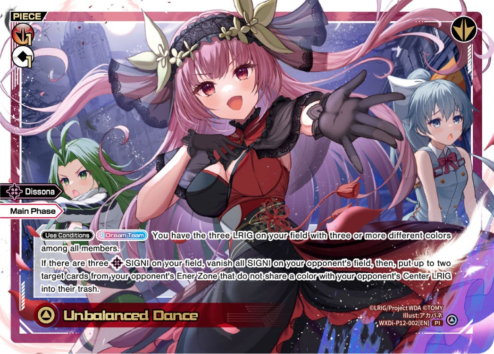

# Unbalanced Dance

## Thông tin lá

| Trường | Giá trị |
| --- | --- |
| Mã in | WXDi-P12-002[EN] |
| Set | WXDi-P12[EN] |
| Số thứ tự | 002 |
| Loại thẻ | PIECE |
| Vị trí | LRIG Deck |
| Số bản | — (set booster, không áp dụng) |
| Màu | Đỏ |
| Độ hiếm | PI,LRP |
| Minh họa | アカバネ |
| Level | — |
| Limit | — |
| Power | 0 |
| LRIG type / Class | — |
| Team / Master | — |
| Cost | 《R》×１ / 《C》×１ |
| Grow cost | — |
| Use timing | Main Phase |
| Life Burst | Không |

## Card text chính thức

[Use Conditions] [Dream Team] You have the three LRIG on your field with three or more different colors among all members.

If there are three {Dissona Icon} SIGNI on your field, vanish all SIGNI on your opponent's field, then, put up to two target cards from your opponent's Ener Zone that do not share a color with your opponent's Center LRIG into their trash.

## Power text / Life Burst

—

## Ghi chú minh họa
Artist: アカバネ. Ảnh PI được tải từ Card List tiếng Anh.

## FAQ chính thức

**Q. May my opponent's SIGNI that was vanished in the first sentence of the effect be put from the Ener zone to its owner's trash in the next sentence?**
A. Yes, as long as it does not share a color with your opponent's Center LRIG. If the effect says "then", perform the effect up to that point and then choose a subsequent target.

**Q. What happens if I use this PIECE when there are not three SIGNI with {Dissona Icon} on my field?**
A. In this case, the condition is not met, so none of the effects are resolved and the effect ends without anything happening.

## Ảnh biến thể

- [LRP](../images/WXDi-P12-002P-EN.jpg)

## Nguồn
[Card List/FAQ chính thức](https://www.takaratomy.co.jp/products/en.wixoss/card/card.html?card_no=WXDi-P12-002%5BEN%5D ) · [Ảnh thẻ](https://www.takaratomy.co.jp/products/en.wixoss/card/thumb/WXDi-P12-002%5BEN%5D.jpg)
