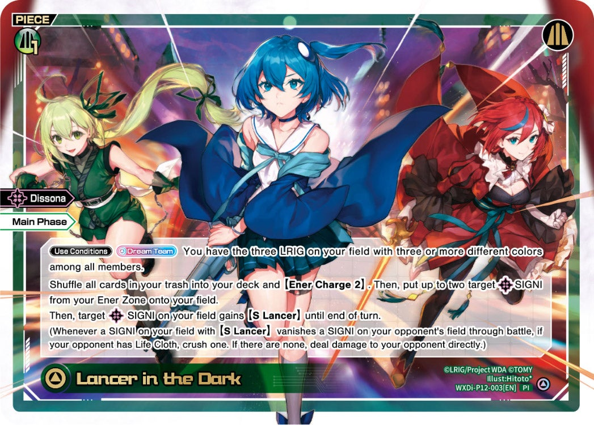

# Lancer in the Dark

## Thông tin lá

| Trường | Giá trị |
| --- | --- |
| Mã in | WXDi-P12-003[EN] |
| Set | WXDi-P12[EN] |
| Số thứ tự | 003 |
| Loại thẻ | PIECE |
| Vị trí | LRIG Deck |
| Số bản | — (set booster, không áp dụng) |
| Màu | Xanh lá |
| Độ hiếm | PI,LRP |
| Minh họa | Hitoto* |
| Level | — |
| Limit | — |
| Power | 0 |
| LRIG type / Class | — |
| Team / Master | — |
| Cost | 《G》×１ |
| Grow cost | — |
| Use timing | Main Phase |
| Life Burst | Không |

## Card text chính thức

[Use Conditions] [Dream Team] You have the three LRIG on your field with three or more different colors among all members.

Shuffle all cards in your trash into your deck and 【Ener Charge 2】. Then, put up to two target {Dissona Icon} SIGNI from your Ener Zone onto your field.
Then, target {Dissona Icon} SIGNI on your field gains 【S Lancer】 until end of turn.
(Whenever a SIGNI on your field with 【S Lancer】 vanishes a SIGNI on your opponent's field through battle, if your opponent has Life Cloth, crush one. If there are none, deal damage to your opponent directly.)

## Power text / Life Burst

—

## Ghi chú minh họa
Artist: Hitoto*. Ảnh PI được tải từ Card List tiếng Anh.

## FAQ chính thức

**Q. May I put SIGNI on the field that was put on the Ener zone with the first 【Ener Charge 2】 and have it gain 【S Lancer】?**
A. Yes, it is possible. If the effect says "then", the effect is performed up to that point and then choose a subsequent target.

## Ảnh biến thể

- [LRP](../images/WXDi-P12-003P-EN.jpg)

## Nguồn
[Card List/FAQ chính thức](https://www.takaratomy.co.jp/products/en.wixoss/card/card.html?card_no=WXDi-P12-003%5BEN%5D ) · [Ảnh thẻ](https://www.takaratomy.co.jp/products/en.wixoss/card/thumb/WXDi-P12-003%5BEN%5D.jpg)
